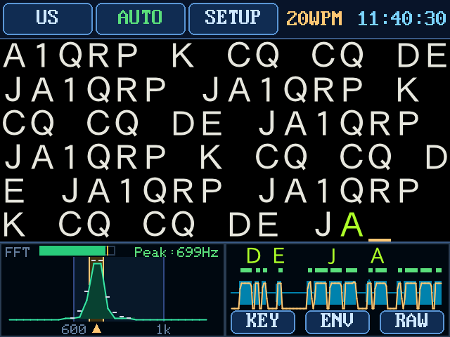

# CW Decoder for ESP32

ESP32 ボード (2.8inch CYD 系: ST7789 / ILI9341 240x320 + XPT2046 タッチ) で動作する CW Decoder です。  
VS Code + PlatformIO + Arduino + LovyanGFX でビルドできます。  
現在のバージョンは `v3.4` です (`src/version.h` の `FW_VERSION`)。  
使い方は **[取扱説明書](docs/manual.md)** を見てください。

CH32V003 / CH32V006 (UIAPduino) 版は
[UIAP_CWDecoder2](https://github.com/pokibon3/UIAP_CWDecoder2) を参照してください
(こちらも `v2.0` としてノイズ対策を反映済み)。

## 対応ハードウェア

- ESP32 (esp32dev / 240MHz デュアルコア)
- LCD: 2.8inch 240x320 (SPI 40MHz)。コントローラは **ST7789 / ILI9341** の両対応
- タッチ: XPT2046 (抵抗膜、ソフトSPI)
- オーディオ入力: GPIO35 (ADC1_CH7) をADC continuous DMAで32kHz取得し、4点平均で8kHz化
  (ESP32 の ADC continuous は `sample_freq_hz` の 9/11 倍でしか変換しないため、要求値は 11/9 倍の 39111Hz にしています)

### LCD コントローラの選択

`platformio.ini` の `build_flags` で指定します。

- 無指定 (デフォルト): 起動時に自動判定 (ID4=0xD3 を読んで ILI9341 を識別、応答が無ければ ST7789)
- `-DPANEL_ST7789`: ST7789 に固定
- `-DPANEL_ILI9341`: ILI9341 に固定

ILI9341 は ID 読み出しに応答しない個体があり、その場合は自動判定できないので
`-DPANEL_ILI9341` を明示してください。ILI9341 は ST7789 に対して表示の基準面が
180° 回転しているため、パネル設定側 (`offset_rotation`) で吸収しており、表示コードと
タッチ校正は両コントローラで共通です。起動時にシリアル (115200) へ
`[lcd] panel = ...` と判定結果を出力します。

タッチ座標はパネル側とタッチ側の `offset_rotation` を足して回るので、タッチ側は
パネルの分を打ち消した値を `init_auto()` が入れ直します (ST7789 は 2 / ILI9341 は 0)。
これを揃えないと ILI9341 でタッチだけが 180° ずれ、時計画面の下段ボタンを押したつもりが
デコーダ画面に戻る、といった動きになります。

## 機能

モールス信号 (欧文 / 和文) をオーディオ入力からデコードし、LCD に表示します。



**画面の見方・操作・時計・SETUP の使い方は [取扱説明書 (docs/manual.md)](docs/manual.md) にあります。**

### 信号処理

- トーン検出は 3ビン float Goertzel (窓長 118 サンプル = 帯域 67.8Hz、判定周期 7.375ms、
  サイド±271Hz は矩形窓 Dirichlet 核のヌル上)
- サイド判定は幾何平均 √(low×high) + 「中心 > max(サイドEMA, サイド瞬時)」条件で、
  低域から裾を引く傾斜ノイズ (バンドノイズ) による偽符号を抑止
- 近サイド (±136Hz) 比は ON 2.0 / OFF 3.2 と非対称。OFF 側を高くすることで、ノイズ下で
  振幅条件だけでは解除できないキーイングのギャップを確実に検出する (ON 側を上げると
  立ち上がりの近サイド漏れで短点の頭が削られるため上げない)
- TONE AUTO モード (デフォルト): 500〜1000Hz の最強ピークへゲート中心を自動同調
  (手動 TONE は 600〜1000Hz、待機は 600Hz `DSP_AUTO_IDLE_HZ`)。受信中は±25Hz の微修正のみ、信号断で最後の周波数をホールド。
  AUTO を選び直したときは待機周波数 (600Hz) から探し直す (手動 1000Hz から AUTO へ送って 1000Hz に居座らせない)
- `NR` ON のときは適応型ラインエンハンサ (ALE) を併用する。ALE は NLMS の線形予測器
  (64 タップ、予測遅延 16 サンプル = 2ms) で、2ms 以上離れると相関が無くなるノイズは予測できず、
  周期的なトーンだけを予測できる。その予測出力から取った中心ビンを**振幅しきい値とノイズ床**に使い、
  **純音判定 (サイド比)** は従来どおり生入力の中心ビンとサイドビンで行う。ALE は信号に合わせた
  狭い BPF として働くのでノイズ床が下がり、相対スケルチが下がる (= 弱い信号を拾える)。
  純音判定まで ALE の出力で行うと、ALE が作るスペクトルの傾きを純音と取り違えて偽符号が出る。
  生入力の窓は ALE の遅れ (D + L/2 サンプル) だけさかのぼって時刻をそろえる。
  実測 (BPF Q=3 込み、Web 版の `web/tools/aletest.mjs`): 合成 20WPM −6dB で 71% → 84%、
  −7dB で 16% → 58%、40WPM は同等、正解文のある実録音 2 本で 97.3% → 98.7% / 74.4% → 83.3%、
  7MHz の実ノイズ 10 分の偽文字 7.8 → 0.8 個/分
- 振幅しきい値は直前のマーク振幅を追う EMA (立ち上がり τ44ms / 下降 τ0.35s のピークホールド型) で、
  床はノイズ床推定 ×8 に連動 (ON 下限 = ノイズ平均の 4.8 倍 の相対スケルチ。
  ノイズの瞬時値は平均の 4 倍程度まで出るので、これを下回るとギャップ中に再点火して符号が融合する)。
  入力レベルを変えてもノイズ耐性が変わらない
- 速度推定には現在値に依存しない再同期を併用する。直近 8 個のマーク長に 1:3 の構造があれば
  そこから単位長を直接求め、現在値と 35% 以上ずれていたら引き戻す。これが無いと、推定が高い側へ
  ずれたときに本物の短点が「短すぎ」で捨てられ、本物の長点が短点と誤認されて推定がさらに上がる
  正帰還に陥り、いったん遅くなると速い CW に追従できなくなる
- 速度推定: マーク長 (短点 1 / 長点 3) を主に使い、ギャップは直前マークとの 1:3 スナップにだけ使う。
  短点に満たない短いマーク (0.6 単位未満) は同程度のものが 3 連続したときだけ採用、
  ±35% を超える大きなスナップは 2 連続で整合したときだけ適用
  (ノイズの偽マークやギャップの分断で WPM が跳ね、短窓に切り替わる連鎖を防止)
- 符号内/文字間の境界はキーイングの重み (符号内スペース長 ÷ 短点長) に追従する。
  重みは送り手によって 1:1 とは限らず、実測した POTA QSO 録音は 1.63 倍あった
  (短点 51ms / 長点 165ms に対し符号内スペース 83ms。長点比 3.24、語間 6.8 短点は標準的で、
  崩れているのは符号内スペースだけ)。マーク由来の単位長だけで「1.5 単位以上は文字間」と
  切ると符号内スペースが全て文字間と判定され、1 文字が要素ごとにばらけて E/T だらけになる。
  境界は「実測した符号内スペース長」と「あるべき文字間 (3 単位)」の中点に置く
  (符号内スペース推定は 0.75〜2.0 単位に拘束)。境界を 3 単位に錨で繋いであるので、
  推定が上限 2.0 まで振れても境界は 2.5 単位にしかならず、3 単位の文字間を飲み込む
  正帰還には構造上入らない。速度追従中に推定が古いままでも境界が暴れないのも同じ理由。
  変数どうしの乗除算は使っていない (CH32V 版の既定ターゲット CH32V003 は RV32EC で
  ハード乗算も除算も無いため、同じ変更をそのまま移植できるようにしてある)
- ノイズブランカは realstate を上下カウンタで積分して判定する (反転に単位長の約 0.35 ぶんの
  ブロック数が必要)。「N ms 安定したら反映」方式はしきい値付近で判定が往復するとタイマーが
  リセットされ続けて反映されず、ノイズ下で符号が融合していた
- 符号にならない短いマーク (< 0.6 単位) はギャップを分断しない (前後の無音を 1 つのギャップとして測る)
- デコード状態機械 (トーン判定ヒステリシス、ノイズブランカ、ギャップ利用の速度推定) は
  CH32 版 v1.9 と同等。タイミングはサンプル数由来のブロッククロック (59 サンプル = 7.375ms/ブロック)
- DSP/デコーダは Core 0、描画は Core 1 に分離

### OTA とパーティションの注意

**注意: OTA 対応でパーティション構成を `min_spiffs.csv` (app 1.875MB x2) に変更しました。**
v2.0 以前から更新する場合は、最初の 1 回だけ USB で書き込んでください (以後は OTA で更新できます)。

**空き容量に注意**: 自動更新で HTTPS (mbedTLS) を積んだため、firmware.bin が
1.70MB → 1.83MB になりました (app 1.875MB に対して 93%、残り約 135KB)。
これ以上増やすなら、SPIFFS を削って app を広げた独自パーティション表に
変える必要があります (その場合は再び USB 書き込みが 1 回必要)。

## USB 書き込みツール (ブラウザ)

<https://pokibon3.github.io/cw_decoder4/flasher/> を開くと、本体を USB で PC につないで
ファームウェアを書き込めます。PlatformIO もドライバ以外のインストールも要りません
(Web Serial API + Espressif 公式の [esptool-js](https://github.com/espressif/esptool-js) 0.6.1。
`web/flasher/vendor/` に同梱)。OTA (自動更新 / SETUP の FW更新) とは別の手段で、次の用途向けです。

- **過去の版への書き戻し**: v2.4〜最新のどれでも選べる (各版の変更の要約つき)
- **設定 (NVS) の初期化**: タッチ補正・WiFi・夏時間・時計の地域・NR などをすべて既定値に戻す。
  タッチ位置がおかしくなって画面から戻せないときにも使える
- **フラッシュ全体の消去**: 原因のわからない不調のとき

対応環境は **Mac / Windows の Chrome または Edge** (Safari・Firefox は Web Serial 非対応)。
基板の USB シリアルは CH340 で、最近の macOS は標準で認識します。Windows でポートが
出ないときは WCH の CH340 ドライバを入れてください。

接続すると本体をリセットして起動ログ (`[boot] v3.4 …` / `[lcd] panel = …`) を読み、
いまの版とパネルを表示してパネルの選択も合わせます。書き込み後も起動ログで、選んだ版で
起動したことを確かめます。ログは画面に出さず、読み取ったらポートを閉じます
(本体のログを見るときはスコープビューアを使う)。違うパネル用を選ぶと警告します (書くと表示が上下逆になるが、
正しいパネルで書き直せば戻る)。

書き込む内容 (`min_spiffs.csv` の配置):

| アドレス | 内容 | 備考 |
|---|---|---|
| `0x1000` | bootloader.bin | 両パネル共通 |
| `0x8000` | partitions.bin | 両パネル共通 |
| `0x9000` | (NVS、0x5000 バイト) | 「設定を初期化」のときだけ 0xFF で埋める |
| `0xE000` | boot_app0.bin | **起動先を app0 に戻す**。OTA で更新した本体は app1 から起動しているので、これが無いと app0 を書き換えても古いファームが起動し続ける |
| `0x10000` | firmware_<パネル>.bin | 選んだ版 |

v3.4 までの `tools/v<版>/` にはアプリ (firmware_*.bin) しか残していないので、ブートローダー類は
`tools/common/` (v3.4 のビルド) を全版で共用します。パーティション表は v2.1 から変わっておらず、
v2.4 のアプリがこの組み合わせで起動することは実機で確認しました。今後の版は
`tools/make_release.sh` がブートローダー類も `tools/v<版>/` に書き出します。

配布物は Pages の公開時に `tools/make_versions.py` が組み立てます (全版の bin と、版・日付・
変更の要約・サイズ・MD5 の目録 `firmware/versions.json`。要約は本 README の変更履歴から取る)。
書き込み速度は 460800bps で、失敗したら 115200bps でやり直します
(この基板の CH340 は 921600bps だと同期が乱れて書けなかった)。

手元で試すとき:

```sh
python3 tools/make_versions.py web    # web/firmware/ に全版と目録を置く (git には入らない)
sh web/serve.sh                        # http://localhost:8777/flasher/ を開く
```

## Web 版

<https://pokibon3.github.io/cw_decoder4/> で公開しています。デコーダ・書き込みツール (`flasher/`)・
スコープビューア (`scope/`) はそれぞれアプリとしてインストールできます (Chrome / Edge のアドレスバーの
インストールアイコンか、画面の「インストール」ボタン)。インストールしたアプリはオフラインでも開けます。

ブラウザで動く版が `web/` にあります。**この README の信号処理の記述はそのまま
Web 版にも当てはまります**。`src/dsp.cpp` / `decoder.cpp` / `decode.cpp` /
`lib/float_fft` をファームウェアと共有し、WebAssembly でそのまま実行するためです
(Emscripten は不要。clang の wasm32 + `wasm-ld` でビルド、出力は約 13KB)。

```sh
sh web/serve.sh        # サーバーを立てて http://localhost:8777/ を開く
```

AudioWorklet はサーバー経由でしか読み込めないため、`file://` で直接開いても
動きません (詳細は web/README.md)。

音声の入力元は画面上部のタブで切り替えます。

- **マイク / ライン入力** — 無線機の AF 出力 → USB オーディオ I/F (FT8 と同じ配線)。
  仮想ループバック (BlackHole / VB-CABLE) 経由で PC 内部の音も拾えます
- **タブ音声** — WebSDR や動画の音をそのままデコード (Chrome 系のみ)
- **音声ファイル** — 録音を再生してデコード。同じ音源で何度でも再現できます
- **テスト信号** — WPM / トーン / S:N を振れる内蔵 CW 発生器。ハード無しで試せます

時計 / NTP / WiFi / OTA / タッチパネル調整 / ログ出力は Web では意味がないので
載せていません。詳細と回帰試験の使い方は [web/README.md](web/README.md) を参照してください。

**入力段の BPF について**: 実機は ADC の手前に多重帰還型バンドパス (中心 700Hz / Q=5) が
入っており、ファームのしきい値・ノイズ床推定・サイドビン判定はその帯域制限された入力を
前提に調整されています。Web 版はこれを BiquadFilter で等価に再現しています (既定 ON)。
無効にすると帯域外ノイズでデコード率が大きく落ちます
(ノイズ混じりの録音での実測: BPF なし 44% → 実機相当 93%)。

### デコーダの回帰試験

```sh
node web/tools/selftest.mjs
```

合成 CW を中核に食わせてデコード結果を照合します。ブラウザもマイクも実機も要らないので、
しきい値やノイズ対策を触ったときの確認に使えます。

## PC シミュレータ (sim/)

ESP32 版の画面を Mac (Linux も可) のウィンドウで動かします。`src/` のファームウェア
(`main.cpp` の `setup()`/`loop()`、画面、SETUP、時計、DSP、デコーダ) をそのままコンパイルし、
ESP32 にしかない部分だけを `sim/sim_main.cpp` で置き換えています。

- LCD とタッチ → SDL のウィンドウとマウス (LovyanGFX の SDL 版)
- 音声入力 (ADC) → 音声ファイル (ffmpeg で 8kHz に変換) か、合成した CW。
  実機のアナログ BPF (700Hz, Q=5) も掛ける
- NVS → `sim/nvs.txt` (消せば工場出荷状態)
- WiFi / NTP / OTA → 電波は使わない。WiFi設定 / FW更新の画面 (`ota.cpp`) はスタブの上で表示だけ動く
  (端末はつながってこない)。時刻は PC の時計を JST として入れる

```sh
brew install sdl2 ffmpeg       # ffmpeg は音声ファイルを使うときだけ
pio run -e esp32dev            # LovyanGFX を .pio/libdeps/ に取ってくる (初回だけ)
cd sim
make run                       # 合成した CW で起動
./build/cwsim ../web/tools/pota_qso.mp3     # 音声ファイルで起動
./build/cwsim --help           # オプション (文・速さ・S/N・入力レベルなど)
```

マウスの左ボタンがタッチ、`B` キーが BOOT ボタン、`S` キーでスクリーンショット
(`sim/shots/` に PNG) です。

[取扱説明書](docs/manual.md) の画面写真は `cd sim && make shots` で撮り直せます (`docs/images/` に 640x480 の PNG)。
写真は画面写真用の `build/cwsim-hd` (Mac 専用) で撮ります。ファームの描画を 2 倍の座標で描き、
文字の字形だけを CoreText でなめらかに描き直したものです。描く書体は、本体のビットマップフォントの
元になった書体そのもの (IPA ゴシック / IPA P ゴシック、Orbitron Light、DejaVu Sans、FreeSans Bold、
時計の数字は Arial) で、初回の `make shots` で `sim/fetch_fonts.sh` が `sim/build/fonts/` に取ってきます
(要ネット接続、リポジトリには入れない)。文字の位置と送り幅も元のフォントのままなので、
字の形も配置も実機と同じで、段々だけが無くなります。元から点で作られた書体 (ボタンの英字・
FFT の小さい字・起動画面の小さい字) は元の書体が無いので、点のまま 2 倍にしています。
実機と同じ画素で確かめたいときは `build/cwsim` を使います。
撮る手順は `sim/shots.txt` (和文の画面は `sim/shots-jp.txt`) に台本として書いてあり、
待ち時間・タップ・撮影を順に実行します (全部で約 5 分)。
合成する文 (`--text`) にはカタカナも書けます。カナが出てくると「ホレ」、和文の途中の英字の前には
「ラタ」を自動で挟むので、デコーダは実機と同じく自動で和文モードに切り替わります。
画面を変えたら撮り直してください。

## ハード接続

| GPIO | 用途 |
|---|---|
| 14 | LCD SCK |
| 13 | LCD MOSI |
| 12 | LCD MISO |
| 2 | LCD DC |
| 15 | LCD CS |
| 21 | LCD BL |
| 35 | MIC / ADC1_CH7 |
| 0 | BOOT ボタン |
| 25 | タッチ SCK (XPT2046) |
| 32 | タッチ MOSI |
| 39 | タッチ MISO |
| 33 | タッチ CS |
| 36 | タッチ INT (未使用) |

MIC 入力は GPIO35 (ADC1_CH7) を使用します。ADC continuous DMAは
ESP32でADC1のみ対応するため、GPIO27 (ADC2) は採用していません。
入力には約 1.65V の DC バイアスを与えてください。
ESP32 の ADC は約 2.45V 以上で非線形になるため、FFT パネルの入力レベルメーター (dB 表示) が
**黄の目盛 (−5 dBFS ≈ 0.85V ピーク) より左に収まるレベル**で使ってください。黄〜赤 (圧縮歪み) や
`CLIP` 点灯 (レール到達) の状態ではサイドビンが上がってデコード率が落ちます。
デコーダのしきい値は相対的 (ノイズ床基準) なので、0.1V ピーク程度 (−24 dBFS) の入力でも正常に動作します。

## ビルド

VS Code でこのフォルダを開き、PlatformIO IDE の機能を使ってビルドします。

1. VS Code でこのプロジェクトを開く
2. PlatformIO IDE が有効になっていることを確認する
3. 画面下部の PlatformIO ツールバーから `Build` を実行する

environment は LCD コントローラごとに分けてあります。

| environment | パネル | 出力 |
|---|---|---|
| `esp32dev` | ST7789 | `.pio/build/esp32dev/firmware.bin` |
| `esp32dev_ili9341` (既定) | ILI9341 | `.pio/build/esp32dev_ili9341/firmware.bin` |

```sh
pio run                                    # 既定 (ILI9341)
pio run -e esp32dev                        # ST7789
pio run -e esp32dev -e esp32dev_ili9341    # 両方
```

`default_envs` が ILI9341 なので、`pio run -t upload` は ILI9341 用を焼きます。
**ST7789 のボードへ書き込むときは `-e esp32dev` を明示してください。**

**焼くパネルと一致しない bin を書き込むと、表示の基準面が 180° ずれてタッチの
回転補正も連動して狂います。** 起動時にシリアル (115200) へ `[lcd] panel = ...` と
判定結果が出るので、そこで確認できます。

### OTA 配布用の bin

```sh
sh tools/make_release.sh
```

`src/version.h` の `FW_VERSION` を読んで両方をビルドし、次の場所へ書き出します。
書き出したあと、焼き込まれたパネル指定が名前と一致しているか検査します。

```
tools/v2.4/firmware_ST7789.bin
tools/v2.4/firmware_ILI9341.bin
```

OTA でアップロードするのはこの `firmware.bin` だけです
(`bootloader.bin` / `partitions.bin` は USB 書き込みでしか更新されません)。

### 自動更新 (オンライン配布)

同じスクリプトが目録 `web/firmware/latest.txt` (version / build / パネル別の size, md5)
も書き出します。bin はリポジトリに二重で持たせず、公開時に Actions が `latest.txt` の
版数を見て `tools/v<版>/` から配ります。

**リリース手順は次のとおり**です。

1. `src/version.h` の `FW_VERSION` を上げる
2. `sh tools/make_release.sh`
3. `tools/v<版>/` と `web/firmware/latest.txt` を commit して push

公開後、本体の「自動更新」が起動時に見にくる URL:

```
https://pokibon3.github.io/cw_decoder4/firmware/latest.txt
```

本体は `latest.txt` の `version` を自分の `FW_VERSION` と major.minor で比べ、
新しいときだけ確認ダイアログを出します。ダウンロードした bin は `latest.txt` の
MD5 と照合してから起動パーティションを切り替えるので、途中で切れたり配布物と
食い違ったりしたときは旧ファームがそのまま残ります。
なお **サーバ証明書の検証はしていません** (改竄検出は上記 MD5)。証明書を焼き込むと
CA が変わったときに「更新できないファームを更新で直せない」状態になるため、
自動更新の経路としてはこの形にしてあります (`src/fwupdate.cpp` 冒頭の注記を参照)。

## 変更履歴

`v1.x` は CH32V003/V006 (UIAPduino) 時代の履歴です。

- Web 版
  - デコーダ・書き込みツール・スコープビューアの 3 つをインストールできるようにした (PWA。Chrome / Edge の
    アドレスバーのアイコンか、画面の「インストール」ボタンから)。オフラインでも開ける (ファームウェアの配布物を除く)
  - デコーダの検出方式の選択 (評価用の A〜E) をやめ、`NR` のチェックボックス (既定 ON = 実機の NR と同じ方式 E) にした
  - スコープビューアを `tools/scope_viewer.html` から `web/scope/` へ移して公開した
  - USB 書き込みツール `web/flasher/` を追加 (v2.4〜最新の書き込み、設定の初期化、全消去)
  - ブラウザ版 `web/` を追加。DSP/デコーダはファームと同一ソースを WebAssembly 化
  - DSP タスクの本体を `dsp_step()` として切り出し、外部から 1 ブロックずつ駆動できるように
    (ESP32 側の挙動は不変。Web では AudioWorklet が供給できたぶんだけ呼ぶ)
  - 画面整理: 各タブの「説明」と GPL のフッタを廃止し (操作の説明は
    [web/manual.html](web/manual.html) に一本化)、空いた縦方向をデコード文字欄へ。
    動作状態とエラーは画面一番下の状態行に集約。タイトル行と使い方の先頭にバージョン表示
  - 操作: マイク行を 再検索 / 開始 / 終了 の順に (旧「入力を止める」を改名して移動)、
    音声ファイルは選択した時点で先頭から再生、テスト信号の送出ボタンを「送信」に、
    テスト文字列を実在しない `JA1QRP` に変更
  - ボタン・セレクト・テキスト入力の高さを 32px に固定 (パディング任せでは
    `select` の `line-height: normal` 強制で 2〜3px ずれる)。枠の明るさは全部そろえ、
    強調は地色だけに任せる (枠だけ明るいとその 1 個が膨らんで見える)
- V3.4 (v3.3 は配布しておらず、その変更もここに含む)
  - 適応型フィルタ (ALE: 適応型ラインエンハンサ) によるノイズ低減 `NR` を追加した (SETUP の `NR`、既定 ON、
    設定は NVS に保存)。ON で弱い信号を拾いやすくなり、ノイズからの偽文字が減る ([信号処理](#信号処理) 参照)。
    実測で合成 20WPM −6dB の正解率 71% → 84%、正解文のある実録音 2 本で 97.3% → 98.7% / 74.4% → 83.3%、
    7MHz の実ノイズの偽文字 7.8 → 0.8 個/分。OFF (従来方式) は入力レベルが高いと局間の弱い信号を拾って
    正解率が下がるが、ON はレベルによらずほぼ一定
  - NR ON のときは振幅しきい値の絶対床を 140 → 40 に下げる (ALE でノイズ床が下がっており、140 のままだと
    小音量の弱い信号を削るだけだった)。ALE の出力は float で保持 (int16 に丸めると小音量で精度が落ちた)。
    合成 20WPM −5dB で入力ピーク 5% のとき 70.9% → 92.4% になり、入力レベル 5〜140% で正解率がほぼ一定
  - 世界時計で選んだ国を NVS に保存し、再起動しても同じ国の時刻を表示するようにした
  - タッチの既定の補正値をパネルごとに分けた。ST7789 基板は ILI9341 と共通の既定値だと
    触った位置より下で反応していたので、実機の校正値から既定値を決め直した
  - 開発途中の v3.3 では NR をステータス行のボタンにし、SETUP を文字エリア中央の長押しで開く形にしていたが、
    v3.4 で NR を SETUP の項目へ移し、ステータス行の `SETUP` ボタンと中央タップの動きは v3.2 と同じに戻した
- V3.2
  - 略号 `UR` (`..-.-.`) を追加。`UR 5NN` のように RST の前へ続けて送られる
  - 重み追従から変数どうしの乗除算を排除。同じロジックを共有する CH32V 版の既定ターゲット
    CH32V003 は `rv32ec` でハード乗算も除算も無く、CH32V006 の `rv32ec_zmmul` も乗算だけで
    除算は無い。比 (符号内スペース ÷ 短点) で持つと比を測るのに変数どうしの除算が要るので、
    符号内スペース長そのもの (ms) を持つ形に変えた。境界式が 3 単位に錨を降ろしているので
    比にしなくても速度追従中に境界が暴れない。デコード結果は実経路の実録音で v3.1 と同一
- V3.1
  - キーイングの重み (符号内スペース ÷ 短点) に追従するようにした。符号内スペースが
    短点の 1.5 倍を超える送信で、それが文字間と判定されて 1 文字が要素ごとにばらけ、
    デコード結果が E/T だらけになっていた (実測した POTA QSO 録音は 1.63 倍)。
    符号内/文字間の境界を「実測した符号内スペース長」と「あるべき文字間 (3 単位)」の
    中点に置く。整った送信 (重み 1.0 付近) では従来と同じ挙動で、実録音の回帰試験も
    変化なし。`selftest.mjs` に重みスイープを追加
- V3.0
  - AUTO 同調を選び直したとき、待機周波数 600Hz (`DSP_AUTO_IDLE_HZ`) から探し直すように
    修正。`TONE` ボタンで 1000Hz から AUTO へ送ると 1000Hz へ居座っていた。
    直前の手動周波数のピークホールドも捨てる (残ると乗り換え条件
    `DSP_AUTO_STEAL_RATIO` に引っかかって引き込みが 1〜2 秒遅れる)
  - Web 版の画面を整理 (詳細は下の「Web 版」)。信号処理はファームと同一ソース
- V2.6〜V2.9 (オンライン自動更新)
  - **オンライン自動アップデート**。起動時 (スプラッシュ直後) に WiFi へ数秒つなぎ、
    NTP 時刻同期と新版チェックを 1 回の接続でまとめて行う。新版があれば画面で
    `更新` / `キャンセル` を選び、`更新` なら GitHub Pages から自分のパネル用の
    bin を取得して書き換え、再起動する (SETUP の `FW自動更新` で ON/OFF、既定 ON)。
    受信中に無線が立たないよう、チェックは ADC DMA を開始する前に済ませる
  - 配布物は `web/firmware/latest.txt` (版数・サイズ・MD5) と `tools/v<版>/` の bin。
    ダウンロードした bin は MD5 を照合してから起動パーティションを切り替えるので、
    途中で切れたり配布物と食い違ったりしたときは旧ファームが残る
  - 書き換え直前にスプライト領域 (89KB) を解放して TLS に回す。mbedTLS は 16KB 級の
    連続領域を複数要求するが、これを抱えたままでは最大連続空きが 36KB しかなく
    接続できない。解放後はスプライトを使う描画ができないので、
    **更新の成否によらず再起動する**
  - SETUP 画面を 2 列 5 行に変更 (項目が 9 個になったため)。確認ダイアログを
    `display_confirm()` として共通化し、項目の並びと名前を整理
    (`ファームウェアアップデート` → `FW更新`、`自動更新` → `FW自動更新`、
    `スコープログ` → `ログ出力`、`タッチ調整` → `タッチパネル調整`)
  - スプラッシュ下端の「BOOT を押しながら電源投入 = タッチ調整を消去」の案内を削除
    (横にはみ出していた)。その行は起動時の時刻同期・更新状況の表示に使う。
    **機能自体はそのまま**で、復帰方法は本 README のタッチ調整の項に記載
  - HTTPS (mbedTLS) を積んだぶん firmware.bin が 1.70MB → 1.83MB
    (app 1.875MB に対して 93%)
  - その他、自動更新まわりのバグフィックス (実機で発生した書き換え開始前後の
    メモリ不足、失敗時の再起動ループ、配布サイズの不一致など)
- V2.5
  - 下段パネルの全幅表示。FFT / オシロの波形部分を**ダブルタップ**すると
    そのパネルが横幅いっぱい (320px) になり、もう一度で戻る。掃引レートや
    周波数レンジは変えないので、見える量がそのまま 2 倍になる。
    FFT のシングルタップ (トーン選択) は従来どおり
  - ノイズだけを受信しているときに E/T が散発的に出るのを抑止。直近 12 文字の
    うち 1 要素の文字が 9 個以上を占めるあいだ、1 要素の文字を捨てる
    (7MHz バンドノイズ 10 分で 540 文字 → 52 文字。実信号側は変化なし)
- V2.4
  - AUTO 同調の無条件追従範囲 `DSP_AUTO_NEAR_HZ` を 70 → 35Hz (ゲートの半値幅)
    に修正。70Hz は検出帯域の半値幅 (±33Hz) の 2 倍以上あり、符号の隙間に
    立ったノイズのピークへ乗り換えてゲートが信号から外れることがあった
    (実録音で 0.6 秒間 600→650Hz へ飛び、その間の文字が脱落。97% → 99%)。
    調査記録は [web/README.md](web/README.md) 参照
- V2.3
  - 時計画面を世界時計に刷新。12 か国 (朝が早い順) のボタンで、パタパタ時計・日付・
    デコーダ画面の時計をその国の時刻に切り替え。夏時間は US / EU / NZ / AU の規則で自動計算
  - SETUP をデコーダ画面のステータス行から直接開けるように (`SETUP` ボタン追加、`SPEED:` 表記は廃止)
  - SETUP を整理し、`Summer Time` の ON/OFF と About 画面 (CW Decoder について) を追加
- V2.2.1
  - OTA モードで AP と同時に自宅 WiFi へ接続 (AP+STA)。mDNS で `cwdec.local` を配るので、
    PC のネットワークを切り替えずに更新できる。LAN 側の IP を画面に表示
- V2.2
  - スコープログ (シリアル) と Web ビューア `tools/scope_viewer.html` を追加。デコーダの内部値を
    実測できるようにし、以下の誤認識をログに基づいて修正
  - ノイズブランカを「N ms 安定したら反映」から上下カウンタの積分方式へ (しきい値付近で判定が
    往復すると永久に反映されない問題を解消)。深さは単位長追従だが上限あり
  - 相対スケルチをノイズ床 ×8 に、近サイド比の OFF 側を 3.2 に (キーイングのギャップの解除)
  - ゲートのホップを半分 (3.75ms) にし、45WPM まで狭帯域 (66.7Hz) を維持
  - マーク履歴からの単位長再同期を追加 (遅い側へ外れた推定から復帰できるように)
  - 入力レベルメーターを dB 表示に、ステータス行に時計を追加
- V2.1
  - パタパタ時計画面を追加（文字エリア中央タップで切替。デコーダは裏で動作継続）
  - SETUP 画面: 時刻合わせ / ファームウェアアップデート (AP 直結 Web OTA) / WiFi設定 (AP 経由、キャンセル可) / WiFi初期化
  - NTP 時刻同期（時計画面表示中のみ、同期中は DSP 一時停止。デコーダ画面では WiFi を起動しない）
  - スプラッシュにバージョンとビルド日時を表示
  - パーティションを `min_spiffs.csv` に変更（初回のみ USB 書き込みが必要）
  - 時計とデコーダ画面のスプライトは 1 つの DMA 対応バッファ (89KB) を共有（WiFi 使用後のヒープ断片化で
    スプライトを作り直せなくなる問題の回避と、WiFi 中の空きメモリ確保を兼ねる）
  - ADC 実効サンプルレートの修正: v2.0 の ADC DMA 化以降、実効 26.2kHz (→8kHz 換算 6.5kHz) で動いていたため
    表示周波数と WPM が約 22% 高く出ていた。要求値を 11/9 倍して実効 32kHz に補正。
    v2.0 のノイズ対策はその 6.5kHz 状態で実機調整されていたので、ブロック長を 48→59 サンプル
    (7.375ms)、窓を 96→118 (67.8Hz)、サイドを ±271Hz にして当時の物理条件を正しいレートで再現
- V2.0 (ESP32 版)
  - ESP32 (Arduino + LovyanGFX) へ全面移植し、リポジトリを ESP32 専用に再構成
  - 音声入力を I2S DMA 化（GPIO35、8kHz）、デコーダをサンプル数由来のブロッククロック駆動に変更
  - 320x240 画面: 16列x6行の 24x24 全角フォント + FFT / オシロ同時表示
  - タッチパネル対応（XPT2046）: US/JP 切替、TONE 切替、FFT パネルでの直接選択
  - トーン判定を 96 サンプル窓に狭帯域化（83.3Hz、+3dB）
  - TONE AUTO モード（550〜1000Hz の最強ピークへ自動同調）を追加しデフォルト化
  - サイド判定の幾何平均化 + side max 条件で傾斜ノイズによる偽符号を抑止
  - スコープ掃引・トーン判定帯域を WPM 追従化（高速受信のデコード率改善）
  - GUI 刷新（ステータス行のボタン化、波形 ON/OFF トグル、Peak 周波数表示）
  - LCD コントローラ ST7789 / ILI9341 両対応（自動判定 + ビルドフラグ）
  - 音声入力を I2S ADC から ADC continuous DMA (32kHz 取得 → 4 点平均で 8kHz) に変更
  - ±167Hz 近サイドビンによる広帯域ノイズ棄却、入力レベルメータ、Peak 表示の安定化
- V1.9
  - トーン判定にヒステリシス（ON 0.6x/3x, OFF 0.4x/2.5x）を導入し、SNR 0dB のデコード誤りをほぼ解消
  - ギャップ（文字内/文字間）も速度推定に利用し、速度変化追従を約2倍高速化
- V1.8
  - Goertzel を3ビン化（中心 + ±341.33Hz サイドビン、Dirichlet ヌル上）し、中心/サイド比によるトーン判定でホワイトノイズ・インパルスノイズを棄却
  - 速度推定を改良（長点も利用して高速収束、短点+長点1:3ペアで20〜35wpm帯へ即時スナップ）
- V1.0〜V1.7
  - OZ1JHM 版をベースに CH32V003/V006 へ移植、Goertzel 化、ST7735/ST7789 対応、フォント改善など

## 参考

製作方法や使い方は、以下も参照してください。  
[R16 Friendship Radio Scrapbox](https://scrapbox.io/r16fr/UIAPduino%E3%82%92%E4%BD%BF%E3%81%A3%E3%81%9FCW_Decoder%E3%81%AE%E8%A3%BD%E4%BD%9C)

## ライセンス

本ソフトのモールスデコーダ部分は、Hjalmar Skovholm Hansen OZ1JHM 氏の Arduino 用 CW Decoder を一部流用しています。  
オリジナルの GPL ライセンス条件が適用されます。

- Original: [http://oz1jhm.dk/content/very-simpel-cw-decoder-easy-build](http://oz1jhm.dk/content/very-simpel-cw-decoder-easy-build)
- GPL: [http://www.gnu.org/copyleft/gpl.html](http://www.gnu.org/copyleft/gpl.html)
