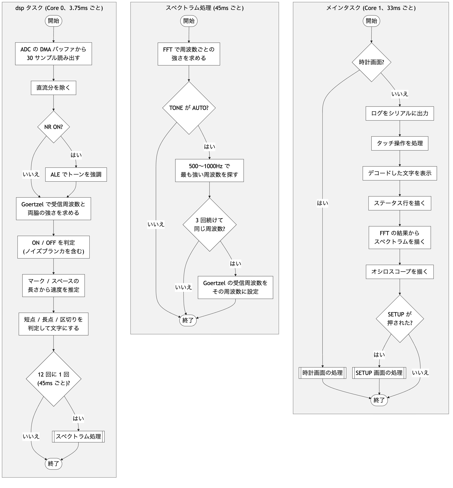

# デコードアルゴリズム

CW Decoder 4 (ESP32 版) が、音声から CW 信号をデコードする処理を説明します。
使用方法は [取扱説明書](manual.md)、ビルドと配布は [README](../README.md) を参照してください。
数値はファームウェア v3.7 のものです。

- [デコードアルゴリズム](#デコードアルゴリズム)
  - [用語](#用語)
  - [全体の流れ](#全体の流れ)
  - [入力](#入力)
  - [トーン検出](#トーン検出)
  - [NR (Noise Reduction) 機能](#nr-noise-reduction-機能)
  - [トーンの ON / OFF 判定](#トーンの-on--off-判定)
  - [ノイズブランカ](#ノイズブランカ)
  - [速度推定](#速度推定)
  - [符号内・文字間・語間の判定](#符号内文字間語間の判定)
  - [文字の確定とノイズ文字の抑止](#文字の確定とノイズ文字の抑止)
  - [TONE AUTO](#tone-auto)

## 用語

| 用語 | 意味 |
|---|---|
| Goertzel (ゲルツェル) | 1 つの周波数成分の強さを求める計算法です。FFT ですべての周波数成分を求める場合より、計算量が少ないことが特徴です |
| FFT | Fast Fourier Transform。入力に含まれる各周波数の成分の強さを、まとめて求める計算法です |
| ビン | Goertzel や FFT で強さを求める周波数の点です。中心ビン = 受信周波数、サイドビン = その両側の周波数 |
| 受信周波数 | 受信しているトーンの周波数です (TONE で選んだ周波数、または TONE AUTO で合わせた周波数) |
| 窓 | 1 回の計算に使う入力の範囲です (直近の何サンプル分を使うか) |
| ブロック | 30 サンプル (3.75 ms) の入力のまとまりです。dsp タスクは、ブロックごとにトーン検出から文字の判定までを行います |
| 単位長 | 短点 1 個の長さです。長点は 3 単位、符号内のスペースは 1 単位、文字間は 3 単位、語間は 7 単位が標準です |
| マーク / スペース | トーンが出ている区間 / 出ていない区間です |
| WPM | Words Per Minute。1 分間に送る語数で、CW の速さを表します |
| ALE | Adaptive Line Enhancer (適応型ラインエンハンサ)。入力から周期的な成分 (トーン) のみを強調する適応フィルタです |
| NLMS | Normalized Least Mean Squares 法。ALE のフィルタの係数を自動で調整する計算法です |
| NR | Noise Reduction。ノイズを減らす機能の総称です。本機の NR は ALE で実現しています (SETUP の `NR(ALE)`) |

ソースは `src/dsp.cpp` (トーン検出・ALE・TONE AUTO)、`src/decoder.cpp` (判定・速度推定・符号の組み立て)、
`src/decode.cpp` (符号から文字への変換、欧文 / 和文) です。

## 全体の流れ

ファームウェアのタスクは次の 2 つです。図の両端に縦線のある箱は、詳細な処理フローを別に示す定義済み処理です。スペクトラム処理のフローは中央の列に示します。

- **dsp タスク** (Core 0): デコードとスペクトラムの計算
- **メインタスク** (Core 1、Arduino の `loop()`): 画面の表示とタッチ操作

<picture>
  <source media="(prefers-color-scheme: dark)" srcset="images/flow-dark.png">
  
</picture>

ADC (Analog-to-Digital Converter) は、ハードウェアによって 32 kHz で変換を継続し、結果を DMA (Direct Memory Access) バッファに格納します。
dsp タスクは、DMA バッファから 30 サンプル (4 点ずつ平均して 8 kHz にした値) を読み出します。30 サンプルがそろうまで読み出しを待機するため、dsp タスクの処理周期は 3.75 ms になります。スペクトラム処理は、その 12 回に 1 回 (45 ms 周期) 実行します。

NR (Noise Reduction) 機能が ON の場合も、純音かどうかの判定 (両側との比) には ALE (Adaptive Line Enhancer) を通す前の値を使用します
([NR (Noise Reduction) 機能](#nr-noise-reduction-機能) を参照してください)。
TONE AUTO の詳しい動きは [TONE AUTO](#tone-auto) を参照してください。

## 入力

- ADC で、GPIO35 (ADC1_CH7) の音声を 32 kHz で取り込みます。
  取り込みには DMA を使用し、4 点ずつ平均して 8 kHz にします。
- 入力には約 1.65 V のバイアス (直流分) が加わっています。直近約 0.13 秒間の入力の平均値をバイアス値とし、各サンプルからその値を減算して、0 を中心とした波形にします。
- ADC の手前のアナログボードに、BPF (Band-Pass Filter) があります
  (中心 581 Hz、Q = 2.7。通過帯域幅は約 210 Hz です。[回路図](schematic.pdf) を参照してください)。

## トーン検出

Goertzel で、受信周波数とその両側 4 か所の周波数の強さを求めます。

| ビン | 位置 | 役割 |
|---|---|---|
| 中心 | 受信周波数 | トーンの振幅 |
| 近サイド | 中心 ±133 Hz | トーンより帯域幅の広いノイズを検出する |
| 遠サイド | 中心 ±267 Hz | 広帯域ノイズやパルス状の雑音を検出する |

**窓とブロック**

- 1 回の計算には、直近 120 サンプル (15 ms) の入力を使用します (窓)。窓が長いほど帯域が狭くなり (66.7 Hz)、ノイズの影響を受けにくくなります。
- 計算は新しいサンプルが 30 個 (3.75 ms) 入るたびに行います (ブロック)。窓の位置を 30 サンプルずつ移動するため、帯域を狭く保ったまま 3.75 ms 間隔で判定できます。

  ```
  time -------------------------------->
  #1  [================]                  120 サンプル (15 ms)
  #2      [================]              30 サンプル (3.75 ms) 後
  #3          [================]
  #4              [================]
  ```

- 45 WPM 以上では窓を 60 サンプル (7.5 ms) に短縮し、40 WPM 以下では 120 サンプル (15 ms) に戻します。また、トーンを約 2 秒間検出しない場合も 120 サンプルに戻します。窓が長い場合、高速な CW では符号間の短い無音を判別できなくなるためです。

**サイドビンによるトーンとノイズの判別**

- Goertzel は 15 ms の入力区間を使用するため、近接した周波数を完全には区別できません。
  たとえば、700 Hz のトーンを 750 Hz で測定した場合も、一定の値が得られます。
- ただし、周波数差が 66.7 Hz (= 1 ÷ 15 ms) の整数倍の場合は、15 ms の間に周波数差に相当する位相が 1 周 (2 周…) して打ち消し合い、0 になります。
- サイドビンはこの位置 (66.7 Hz の 2 倍と 4 倍) に設定されているため、トーンのみの場合、サイドビンはほぼ 0 になります。
  ノイズには複数の周波数成分が含まれるため、サイドビンにも値が現れます。
- 中心ビンのみが大きい場合はトーン、サイドビンも大きい場合はノイズと判定します。
- 遠サイドの低い側と高い側は、掛け合わせて平方根をとった値 (**相乗平均**) で 1 つにまとめます。
  低い周波数ほど強いノイズなど、片側のみが大きい場合もノイズを過小評価しないためです。

FFT は画面のスペクトラム表示と TONE AUTO にだけ使い、トーンの判定には使いません。

## NR (Noise Reduction) 機能

NR 機能は、ALE (Adaptive Line Enhancer) でトーンを強調します。SETUP の `NR(ALE)` が ON (既定) のときに動作します。

- ALE は、入力から同じ波形を繰り返す成分 (トーン) のみを抽出するフィルタです。
- 新しいサンプルが入力されるたびに、2 ms 以上前の 64 サンプル (8 ms 分) から、新しいサンプルの値を推定します。
  トーンは同じ波形を繰り返すため推定できますが、ノイズは不規則であるため推定できません。
  この推定値を ALE の出力とするため、出力ではトーンが保持され、ノイズが減衰します。
- 推定に使う係数は、NLMS 法で、推定値と実際の値の差が小さくなるように自動で調整します。
- ALE の出力は**振幅**にだけ使い、**純音かどうかの判定** (サイドとの比) は生の入力で行います。
  ALE の出力でサイドと比べると、ノイズもトーンと判定されるためです。

ON にすると弱い信号の検出性能が向上し、ノイズによる文字の誤表示を抑制します。

## トーンの ON / OFF 判定

ブロックごとに、次の条件でトーンの ON / OFF を決めます。
ON と OFF の条件は個別に設定されており、どちらも満たさない場合は直前の状態を保持します (境界付近で ON と OFF が頻繁に切り替わることを防止するためです)。

| | 条件 |
|---|---|
| ON (すべて満たしたとき) | 振幅 > しきい値 × 0.6<br>中心 > 遠サイド × 3<br>中心 > 遠サイドの大きいほう<br>中心 > 近サイド × 2.0 |
| OFF (どれか 1 つを満たしたとき) | 振幅 < しきい値 × 0.4<br>中心 < 遠サイド × 2.5<br>中心 < 近サイド × 3.2 |

- **しきい値**は、直前のマークの振幅に合わせて自動的に更新します。増加時は高速、減少時は低速で追従します。
- しきい値は、**ノイズ床** (ノイズの平均的な大きさ) の 8 倍より下げません。ノイズ床は、トーンがないと判断したブロックだけで平均します。
  しきい値がノイズに合わせて変化するため、入力音量の変化による判定への影響を抑制します。

## ノイズブランカ

ON / OFF の判定結果から、短時間の変動を取り除きます。

- カウンタを使用し、ON のブロックで 1 加算し、OFF のブロックで 1 減算します。上限に達した場合は ON、0 に達した場合は OFF にします。
- 上限は単位長の約 0.35 倍 (2〜5 ブロック) です。ON と OFF の切り替えが同じブロック数だけ遅延するため、マークの長さは変化しません。
- ON から OFF へ切り替わる途中は、ON のブロックが上限と同じ数だけ連続するまで、カウンタを加算しません。
  符号内の短い隙間に雑音が入った場合でも、隙間を検出できます (短点 2 つが 1 つの長点として読み取られることを防ぎます)。

## 速度推定

単位長 (短点 1 個の長さ) を推定します。範囲は 24〜300 ms (50〜4 WPM) で、WPM = 1200 ÷ 単位長 (ms) です。

- 主にマークの長さを使います。0.6〜2 単位のマークは短点、2〜6 単位は長点とみなします。
- 直前のマーク (またはスペース) との長さの比がおよそ 3 倍なら、短点と長点の組とみなして単位長を直接求めます。
  それ以外の場合は、マークの長さに向けて推定値を段階的に更新します。
- 直近 8 個のマークに短点と長点 (1:3) の組があれば、そこから単位長を求め直します。推定値の誤差が大きくなった場合も、ここで修正されます。
- ノイズと判断したマーク (短すぎるもの、長い無音のあとに単独で出たもの) は推定に使用しません。ただし、短すぎるマークでも、同程度の長さのマークを 3 回連続して検出した場合は速度推定に使用します。

## 符号内・文字間・語間の判定

スペースの長さで、符号内 (短点・長点の間)・文字間・語間を判別します。

- **符号内と文字間の境界**は、測定した符号内スペースの長さと、標準の文字間 (3 単位) の中間に設定します。
  符号内スペースが短点より長い信号でも、1 文字が複数の文字に分割されることを防止できます。
- **文字間と語間**は、6 単位未満を文字間、6 単位以上を語間とします。

## 文字の確定とノイズ文字の抑止

- 文字間・語間を検出した場合、または無音が 6 単位を超えた場合に、それまでの短点・長点の符号列を文字へ変換します。
- 欧文 / 和文の符号表は `src/decode.cpp` にあります。和文モードでは「ホレ」で和文、「ラタ」で欧文に自動で切り替わります。
  略符号（プロサイン）の AR / KN / BT / VA / HH / BK / UR は 2 文字で表示します。
- ノイズのみの場合は E / T が連続して表示されやすいため、直近 12 文字のうち E / T が 9 個以上ある間は、E / T を表示しません。

## TONE AUTO

TONE が AUTO (既定) の場合は、500〜1000 Hz の範囲で最も強い信号に受信周波数を自動調整します。信号を検出する前は 600 Hz で待機します。

- 45 ms ごとの FFT で、ほかの周波数より十分に強い信号を同じ位置で 3 回連続して検出した場合、その位置に受信周波数を設定します。
- 受信中 (トーン ON) は小幅な補正のみを行い、別の信号には追従しません。
- 符号間 (トーン OFF) のノイズによる影響を防ぐため、離れた周波数へ移動するのは、現在の信号より十分に強い候補がある場合に限定します。
