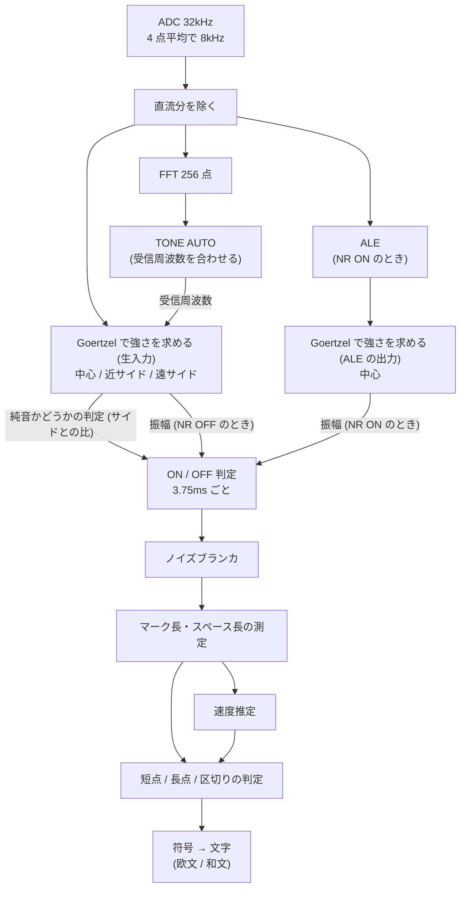

# デコードアルゴリズム

CW Decoder 4 (ESP32 版) が、音声から CW を読み取る仕組みを説明します。
使い方は [取扱説明書](manual.md)、ビルドと配布は [README](../README.md) を参照してください。
数値はファームウェア v3.7 のものです。

- [デコードアルゴリズム](#デコードアルゴリズム)
  - [用語](#用語)
  - [全体の流れ](#全体の流れ)
  - [入力](#入力)
  - [トーン検出](#トーン検出)
  - [ノイズ低減 NR (ALE)](#ノイズ低減-nr-ale)
  - [トーンの ON / OFF 判定](#トーンの-on--off-判定)
  - [ノイズブランカ](#ノイズブランカ)
  - [速度推定](#速度推定)
  - [符号内・文字間・語間の判定](#符号内文字間語間の判定)
  - [文字の確定とノイズ文字の抑止](#文字の確定とノイズ文字の抑止)
  - [TONE AUTO (自動同調)](#tone-auto-自動同調)
  - [実装上の注意点](#実装上の注意点)

## 用語

| 用語 | 意味 |
|---|---|
| Goertzel (ゲルツェル) | 1 つの周波数の成分の強さだけを求める計算法です。FFT ですべての周波数を求めるより計算が軽いのが特徴です |
| FFT | Fast Fourier Transform (高速フーリエ変換)。入力に含まれる各周波数の成分の強さを、まとめて求める計算法です |
| ビン | Goertzel や FFT で強さを求める周波数の点です。中心ビン = 受信周波数、サイドビン = その両脇の周波数 |
| 受信周波数 | 受信しているトーンの周波数です (TONE で選んだ周波数、または TONE AUTO で合わせた周波数) |
| 窓 | 1 回の計算に使う入力の範囲です (直近の何サンプル分を使うか) |
| 平均 (EMA) | EMA は Exponential Moving Average (指数移動平均)。新しい値が来るたびに「平均 = 平均 + (新しい値 − 平均) × 係数」で更新する平均です。係数が小さいほどゆっくり動きます |
| 単位長 | 短点 1 個の長さです。長点は 3 単位、符号内のスペースは 1 単位、文字間は 3 単位、語間は 7 単位が標準です |
| マーク / スペース | トーンが出ている区間 / 出ていない区間です |
| WPM | Words Per Minute。1 分間に送る語数で、CW の速さを表します |
| ALE | Adaptive Line Enhancer (適応型ラインエンハンサ)。入力から周期的な成分 (トーン) だけを強めるフィルタです |
| NLMS | Normalized Least Mean Squares (正規化最小二乗平均) 法。ALE のフィルタの係数を自動で調整する計算法です |
| NR | Noise Reduction (ノイズ低減)。SETUP の `NR(ALE)` のことです |
| S/N | Signal-to-Noise ratio。信号とノイズの強さの比です |

ソースは `src/dsp.cpp` (トーン検出・ALE・自動同調)、`src/decoder.cpp` (判定・速度推定・符号の組み立て)、
`src/decode.cpp` (符号から文字への変換、欧文 / 和文) です。

## 全体の流れ



矢印はデータの流れです。ON / OFF 判定には、純音かどうかの判定 (サイドとの比) と振幅の 2 つを渡します。
純音の判定にはいつも生入力の値を使い、振幅には NR が OFF なら生入力の値、ON なら ALE を通した値を使います。
TONE AUTO は、FFT で見つけた信号の周波数を受信周波数として設定します。

DSP (信号処理) とデコーダは ESP32 の Core 0、画面の描画とタッチは Core 1 で動きます。

## 入力

- ADC (Analog-to-Digital Converter: アナログ / デジタル変換器) で、GPIO35 (ADC1_CH7) の音声を 32kHz で取り込みます。
  取り込みには DMA (Direct Memory Access: CPU を通さずにメモリへ転送する仕組み) を使い、4 点ずつ平均して 8kHz にします。
- 入力には約 1.65V のバイアス (直流分) が乗っているので、ゆっくり動く平均で求めて差し引きます。
- 基板の ADC の手前には、アナログの BPF (Band-Pass Filter: 帯域通過フィルタ) があります
  (中心 700Hz、Q=5。通す帯域の幅は約 140Hz です)。

## トーン検出

Goertzel で、受信周波数の強さを求めます。同時に、その両脇の 4 か所の周波数の強さも求めます。

| ビン | 位置 | 役割 |
|---|---|---|
| 中心 | 受信周波数 | トーンの振幅 |
| 近サイド | 中心 ±133Hz | トーンより幅の広いノイズを見つける |
| 遠サイド | 中心 ±267Hz | 全体に広がるノイズや、パルス状の雑音を見つける |

- 1 回の計算には、直近 120 サンプル (15ms) の入力を使います。この 120 サンプルを「窓」と呼びます。
  窓が長いほど帯域が狭くなり (120 サンプルで 66.7Hz)、トーン以外のノイズが入りにくくなります。
- 計算は 15ms ごとではなく、新しいサンプルが 30 個 (3.75ms) 入るたびに行います。
  毎回、窓を 30 サンプルずつ後ろへずらすので、前回の窓と 90 サンプル (窓の 75%) が重なります。
  この 30 サンプルの区切りを「ブロック」と呼びます。

  ```
  time -------------------------------->
  #1  [================]                  120 サンプル (15ms)
  #2      [================]              30 サンプル (3.75ms) ずらす
  #3          [================]
  #4              [================]
  ```

  こうすると、窓を長くして帯域を狭く保ったまま、トーンの ON / OFF を 3.75ms 刻みで判定できます。
- サイドビン (両脇の周波数) は、トーンとノイズを見分けるために使います。
  - Goertzel は「入力の中に、ある周波数の成分がどれだけ含まれているか」を求めます。
    ただし 15ms の入力だけで計算するので、近い周波数どうしは完全には区別できません。
    たとえば 700Hz のトーンを 750Hz で測っても 0 にはならず、ある程度の値が出ます。
  - 例外は、周波数の差が 66.7Hz (= 1 ÷ 15ms) の整数倍のときです。このときは 15ms の間に
    差の分がちょうど 1 周 (2 周、3 周…) し、足し合わせるとプラスとマイナスが打ち消し合って、ちょうど 0 になります。
  - サイドビンの ±133Hz (66.7Hz の 2 倍) と ±267Hz (4 倍) はこの位置に置いてあるので、
    受信周波数のトーンだけなら、サイドビンの値はほぼ 0 です。
  - ノイズはいろいろな周波数の成分を含むので、サイドビンにも強さが出ます。
  - つまり、中心だけが大きければトーン、サイドも大きければノイズと判断できます。
- 45WPM 以上では、窓を 60 サンプル (7.5ms、帯域 133Hz) に縮めます (40WPM 以下で元に戻します)。
  - 窓が長いと、ON / OFF の切り替わりが前後 7ms ほどぼやけます。速い CW では符号の間の短い無音が埋もれて、
    短点どうしがつながってしまうためです。
  - 窓を半分にすると振幅も半分になるので、2 倍して長い窓とそろえます。
  - 直近 2 秒間に一度も ON にならなければ、WPM によらず長い窓に戻します。短い窓で信号を取り逃がし続けると
    WPM が更新されず、短い窓のまま戻れなくなるためです。
- サイドビンは中心の低い側と高い側に 1 つずつあります。値はブロックごとに揺れるので、
  それぞれ平均した値を使います (新しい値を 1/4 だけ反映する EMA)。
- 遠サイドの低い側と高い側は、掛け合わせて平方根をとった値 (**相乗平均**) で 1 つにまとめます。
  たとえば低い側が 400、高い側が 100 なら √(400 × 100) = 200 です。
  - 低い周波数ほど強いノイズでは、低い側のサイドだけが大きくなります。
    このとき小さいほう (高い側) だけを見ると、受信周波数あたりのノイズを少なく見積もってしまい、
    ノイズをトーンと間違えます。相乗平均なら 2 つの間の値になり、受信周波数あたりのノイズの量に近くなります。
  - トーンを受信しているときは両側とも小さいので、相乗平均にしても感度は変わりません。
- 近サイドは、低い側と高い側のうち小さいほうを使います。片側だけにほかの局の信号があっても、
  その影響を受けないようにするためです。

FFT (256 点) は画面のスペクトラム表示と TONE AUTO にだけ使い、トーンの判定には使いません。
FFT で判定すると、受信トーンの周波数が少しずれただけでサイドビンの値が 0 にならなくなり、
実機でデコード率が落ちたためです。

## ノイズ低減 NR (ALE)

SETUP の `NR(ALE)` が ON (既定) のときは、ALE (Adaptive Line Enhancer: 適応型ラインエンハンサ) を併用します。

**仕組み**

- ALE は、少し前の入力から、いまの入力を予測するフィルタです。
  2ms 前から 8ms 分 (16 サンプル前から 64 サンプル分) の入力を使って、いまの値を予測します。
- トーンは同じ波形を繰り返すので、少し前の入力から予測できます。
  ノイズは 2ms も離れると前の値と関係がなくなるので、予測できません。
  そのため予測した値 (ALE の出力) は、トーンが強く、ノイズが弱くなります。
- 予測に使う係数は、NLMS (Normalized Least Mean Squares: 正規化最小二乗平均) 法で自動的に調整します。
  サンプルごとに予測と実際の値の差 (誤差) を求め、誤差が小さくなる向きに係数を少しずつ直します。
  直す量は入力の強さで割ってそろえるので (これを正規化と呼びます)、入力の音量によらず同じ速さで調整できます。
- 係数が落ち着くと、ALE は受信トーンの周波数だけを通す、ごく狭いフィルタとして働きます。

**使い方**

- ALE の出力から求めた中心ビンは、**振幅** (しきい値とノイズの大きさの基準) にだけ使います。
- **純音かどうかの判定** (サイドとの比) は、これまでどおり生の入力で行います。
  ALE の出力はトーンの周りの周波数が持ち上がった形になるので、これでサイドと比べると、
  ノイズまでトーンに見えて偽の符号が出ます (実測で 8 個/分)。
- ALE の出力は入力より約 48 サンプル (6ms) 遅れて出てくるので、生の入力も同じだけ前のデータを使って、時刻をそろえます。
  そろえないと、振幅と純音の判定で別の時刻を見ることになり、マークが短く測られます。

**調整で分かったこと**

- 正規化に使う入力の強さには、直前の値ではなく約 0.5 秒の平均を使います。
  直前の値だと、キーを押した直後に係数が大きく動きすぎ、マークが 20ms ほど長く測られました。
- ALE の出力は、小数 (浮動小数点数) のまま持ちます。整数に丸めると、音量が小さいときに精度が落ちました。
- NR ON のときは、振幅しきい値の下限を 140 から 40 に下げます。ALE でノイズが小さくなっているので、
  140 のままでは、小さい音量の弱い信号を削るだけになるためです。

**効果** (入力 BPF を通した状態での実測):

| 条件 | NR OFF | NR ON |
|---|---|---|
| 合成した信号 20WPM、S/N −6dB | 71% | 84% |
| 合成した信号 20WPM、S/N −7dB | 16% | 58% |
| 合成した信号 40WPM | 同等 | 同等 |
| 正解文のある実録音 (2 本) | 97.3% / 74.4% | 98.7% / 83.3% |
| 7MHz の実際のノイズ 10 分での偽文字 | 7.8 個/分 | 0.8 個/分 |

NR OFF は入力の音量が大きいと周りの局の弱い信号まで拾って正解率が下がりますが、NR ON は音量によらずほぼ一定です。

## トーンの ON / OFF 判定

ブロックごとに、次の条件でトーンの ON / OFF を決めます。
ON にする条件と OFF にする条件は別々に決めてあり、どちらも満たさないときは直前の状態を保ちます。
こうしておくと、条件の境目の近くで ON と OFF が細かく入れ替わりません。

| | 条件 |
|---|---|
| ON (すべて満たしたとき) | 振幅 > しきい値 × 0.6<br>中心 > 遠サイド × 3<br>中心 > 遠サイドの大きいほう<br>中心 > 近サイド × 2.0 |
| OFF (どれか 1 つを満たしたとき) | 振幅 < しきい値 × 0.4<br>中心 < 遠サイド × 2.5<br>中心 < 近サイド × 3.2 |

**振幅しきい値**

- 直前のマークの振幅に合わせて、自動で動く基準値です。
- 振幅が上がるときはすぐ追いつき (約 23ms)、下がるときはゆっくり下がります (約 0.18 秒)。
  文字と文字の間の無音でもすぐには下がらないので、無音の間のノイズで ON になりません。

**しきい値の下限 (スケルチ)**

- しきい値は、ノイズの平均的な大きさ (以下、ノイズ床) の 8 倍より下げません。
  ON の条件はしきい値の 0.6 倍なので、振幅がノイズ床の 4.8 倍を超えないと ON になりません。
- ノイズだけのときの振幅は大きく揺れ、ときどき平均の 4 倍くらいまで出ます。下限はそれより上に置いています。
  下限が低いと、符号の間の無音でノイズによって ON になり、短点と長点が 1 本につながってしまいます。
- 下限がノイズ床に合わせて動くので、入力の音量を変えてもノイズへの強さは変わりません。

**ノイズ床**

- トーンが無いと思われるブロックだけを使って、ゆっくり (約 0.48 秒) 平均します。
  使うのは、振幅がノイズ床の 2 倍未満のブロックか、トーンらしくない (中心が遠サイドの 2 倍以下) ブロックです。
- ON / OFF の判定結果でブロックを選ばないのは、ON にならなかった信号がノイズとして平均に入ると、
  ノイズ床が信号の大きさまで上がり、二度と ON にならなくなるためです。

**「中心 > 遠サイドの大きいほう」の条件**

- 受信帯域より低い周波数のノイズが強いと、低い側の遠サイドだけが大きくなります。
  相乗平均と比べるだけでは見逃すことがあるので、中心が両側の遠サイドより大きいことも条件にしています。
  本物のトーンなら、中心は必ず両側より大きくなります。
- ここでの遠サイドの値には、平均した値といまのブロックの値の大きいほうを使います。
  短い雑音は、平均がまだ追いつかない最初のブロックですり抜けるためです。

**近サイドの倍率が ON 2.0 / OFF 3.2 と違う理由**

- ON はすべての条件を満たす必要があるので、ここを厳しくすると ON になりにくくなります。
  キーを押した直後は一瞬だけ近サイドにも成分が出るので、短点の頭が削られてしまいます。
- OFF はどれか 1 つで成立します。3.2 倍にしても、振幅が十分大きいマークの最中は ON のままです。
  効くのは、振幅が中途半端に残る符号の間の無音で、ここを確実に OFF にします。
  振幅の条件だけでは、この無音を確実には見つけられません。

## ノイズブランカ

ON / OFF の判定結果から、短いばたつきを取り除きます。

- カウンタを 1 つ用意し、ON のブロックでは 1 増やし、OFF のブロックでは 1 減らします。
  カウンタが上限に達したら ON、0 になったら OFF にします。
  ON と OFF が細かく入れ替わっても、多いほうに落ち着きます。
- 上限は単位長の約 0.35 倍にあたるブロック数です (2〜5 ブロック = 7.5〜18.75ms)。
  5 ブロックを上限にしているのは、対応する最速の 50WPM の短点 (24ms) を消さないためです。
- ON になるときも OFF になるときも同じだけ遅れるので、マークの長さは変わりません。
- 以前は「一定時間同じ状態が続いたら反映する」方式でした。ON と OFF が細かく入れ替わると
  その時間がいつまでも満たされず、ノイズの中で符号がつながっていました。

## 速度推定

単位長 (短点 1 個の長さ) を推定します。初期値は 60ms (20WPM) で、24〜300ms (50〜4WPM) の範囲に収めます。
WPM は 1200 ÷ 単位長 (ms) です。

- **主にマークの長さを使います**。0.6〜2 単位のマークは短点、2〜6 単位のマークは長点とみなします。
  マークは短点 1・長点 3 と長さが決まっているので頼りになりますが、スペースは送り手によって長さが変わります。
  そのためスペースは、直前のマークと 1:3 の関係になっているときにだけ使います。
- **1:3 の組から直接求める**: 直前のマーク (またはスペース) との長さの比が 2.4〜3.6 倍なら、短点と長点の組とみなし、
  そこから単位長を直接求めます (18〜40WPM の範囲になるときだけ)。
  いまの推定と 35% 以上違う値になるときは、2 回続けて同じくらいの値が出たときだけ採用します。
  ノイズで途切れたマークやスペースの切れ端が、たまたま 1:3 に見えることがあるためです。
- **それ以外のとき**: マークの長さ (長点なら 1/3 にした長さ) に向けて、推定を差の 1/3 ずつ近づけます。
- **大きくずれたときの立て直し**: 直近 8 個のマークで、2 番目に短いものと 2 番目に長いものの比が約 3 倍 (2.4〜3.6 倍) なら、
  そこから単位長を求めます。いまの推定と 35% 以上違えば、その値に置き換えます。
  - 推定が長すぎる側へずれると、本物の短点は「短すぎる」として捨てられ、本物の長点は短点とみなされて、
    推定がさらに長くなる悪循環に入ります。立て直しはいまの推定を使わずに計算するので、この悪循環から抜け出せます。
  - 最短・最長ではなく 2 番目を使うのは、外れた値が 1 個まじっても影響を受けないようにするためです。
- **短すぎるマーク** (0.6 単位未満): 同じくらい (±25% 以内) の長さのものが 3 回続いたときだけ使います。
  ノイズの短いマークで WPM が急に上がり、窓が短いほうへ切り替わってさらに崩れる、という連鎖を防ぐためです。
- **前に長い無音 (6 単位以上) があるマーク**: 速度推定には使いません。ノイズの単発に推定が引っぱられるのを防ぐためです。

## 符号内・文字間・語間の判定

スペースの長さで、符号内 (短点・長点の間)・文字間・語間を見分けます。

**符号内と文字間の境界**

- 符号内スペースが短点の何倍あるか (キーイングの重み) は、標準では 1 倍ですが、送り手によって違います。
  実測した POTA (Parks on the Air: 公園からの運用) の交信の録音では 1.63 倍ありました
  (短点 51ms、長点 165ms に対して、符号内スペースが 83ms。長点の比 3.24 倍、語間 6.8 短点は標準的で、
  ずれているのは符号内スペースだけでした)。
- 単位長だけを基準に「1.5 単位以上は文字間」と決めると、この録音では符号内スペースがすべて文字間と判定され、
  1 文字が短点・長点ごとにばらばらになって、E と T だらけになります。
- そこで符号内スペースの長さも測り (平均し、0.75〜2.0 単位の範囲に収める)、
  文字間との境界を、測った符号内スペースと標準の文字間 (3 単位) のちょうど中間に置きます。
  - 重みが標準 (1 倍) なら、境界は (1 + 3) ÷ 2 = 2.0 単位です。
  - 測った値が上限の 2.0 単位になっても、境界は 2.5 単位で、3 単位の文字間より短いままです。
    文字間を符号内と取り違えて、測った値がさらに伸びる、という悪循環は起きません。
  - 境界の片方は常に 3 単位なので、速度が変わる途中で測った値が古いままでも、境界が大きくずれることはありません。

**文字間と語間の境界**

- 単位長を基準に、4.5 単位未満は文字間、6 単位以上は語間とします (その間は文字間)。
  語間は、キーイングの重みの影響をあまり受けません。

**短いマークの扱い**

- 符号にならない短いマーク (0.6 単位未満) があっても、スペースをそこで区切りません。前後の無音を 1 つのスペースとして測ります。
  区切ると文字間が 2 つに割れて短くなり、前後の文字がつながってしまいます (TH が 6 になるなど)。

## 文字の確定とノイズ文字の抑止

- 文字間・語間を見つけたとき、または無音が 6 単位を超えたときに、それまでの短点・長点の並びを文字にします。
  短点・長点は 1 文字 8 個までで、それを超えるとそこで区切ります。
- 欧文 / 和文の符号表は `src/decode.cpp` にあります。和文モードでは「ホレ」で和文、「ラタ」で欧文に自動で切り替わります。
  略符号 (プロサイン) の AR / KN / BT / VA / HH / BK と、U と R を続けて送る `UR` は 2 文字で表示します。
- **ノイズだけのときに出る E / T を抑えます**。直近 12 文字のうち、短点か長点 1 個だけの文字 (E / T) が 9 個以上ある間は、
  そうした文字を表示せずに捨てます。
  - 本物の CW でも E / T は 19〜43% 含まれますが、ノイズだけのときは 70% 前後になります。
  - 捨てた文字も直近 12 文字には数えるので、ノイズが止まれば自然に元に戻ります。
  - 7MHz のノイズ 10 分では、541 文字が 52 文字に減りました。本物の信号のデコード結果は変わりません。
- 長い無音 (6 単位以上) のあとに短点か長点が 1 個だけ来たときは、ノイズの可能性が高いとみなし、
  そのたびに速度の推定を 20WPM の側へ少し戻します。単位長が長くなるとノイズの短いマークが「短すぎる」になり、偽の E が減ります。

## TONE AUTO (自動同調)

TONE が AUTO (既定) のときは、500〜1000Hz で最も強い信号に、受信周波数を自動で合わせます。
手動の TONE は 600〜1000Hz です。信号を見つける前は 600Hz で待ちます。

- 45ms ごとの FFT で、いちばん強い周波数が、ほかの周波数の平均の 3 倍以上あるときだけ信号とみなします。
  周波数は、ピークの両隣の値も使って FFT の刻み (31.25Hz) より細かく求めます。
  3 回 (約 130ms) 続けて ±20Hz 以内に見つかったときだけ、受信周波数をそこへ動かします。
- トーンが ON の間 (受信中) は、±25Hz までの小さな修正だけを行い、別の局へは移りません。
- トーンが OFF の間は、35Hz 以内 (受信帯域の幅の約半分) のずれには、そのまま合わせます。
  それより遠くへ移るのは、新しい候補が、いまの周波数の強さの 1.5 倍以上あるときだけです。
  いまの周波数の強さは最大値を覚えておき、45ms ごとに 3% ずつ減らしていきます。
  - 符号の間・文字の間・語の間もトーンは OFF なので、条件を付けないと、その隙間に出たノイズの周波数へ移ってしまいます
    (35Hz ではなく 70Hz にしていたときは、実録音で 0.6 秒間 600Hz から 650Hz へ移り、その間の文字が抜けていました)。
- 5Hz 以内のずれでは受信周波数を動かしません。信号が消えたら最後の周波数のまま待ちます。
- AUTO を選び直したときは 600Hz から探し直し、覚えていた強さも捨てます。

## 実装上の注意点

- **変数どうしの掛け算・割り算を使わない** (判定・速度推定・キーイングの重み):
  - このデコーダには、小さなマイコン CH32V003 / CH32V006 で動く版 ([UIAP_CWDecoder2](https://github.com/pokibon3/UIAP_CWDecoder2)、以下 CH32V 版) があり、
    デコードの処理は ESP32 版と共通にしています。
  - CH32V003 には掛け算と割り算の命令がなく、CH32V006 にも割り算の命令がありません。
    そのため、変数どうしの掛け算・割り算を使うと、CH32V 版では処理が重くなります。
  - 決まった数を掛ける計算と、2・4・8… で割る計算だけで書いておけば、同じ変更をそのまま CH32V 版へ移植できます。
    符号内スペースを「短点の何倍か」ではなく長さ (ms) で持っているのもこのためです (倍率を求めるには割り算が要るため)。
- **大きなメモリは後から確保する**: スコープの表示用データ (7KB) と ALE のデータ (5KB) は、起動時の更新チェックが終わってから確保します。
  更新チェックの暗号化通信 (TLS: Transport Layer Security) は空きメモリをぎりぎりまで使うため、
  起動時から確保しておくとメモリが足りず、接続に失敗します (v3.4 / v3.5 の不具合)。
