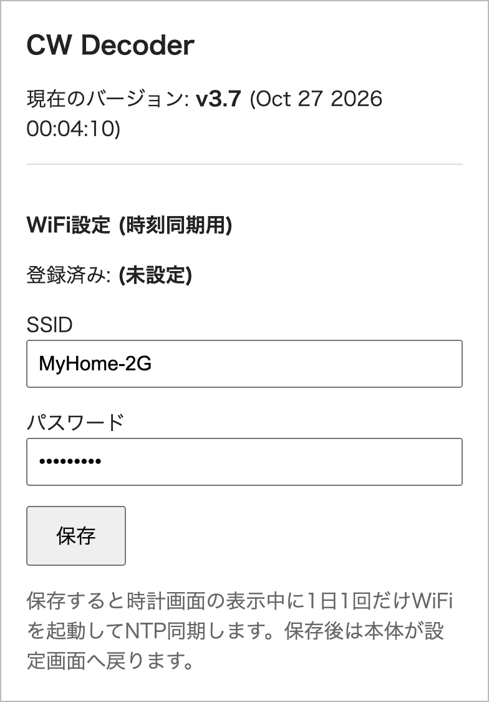
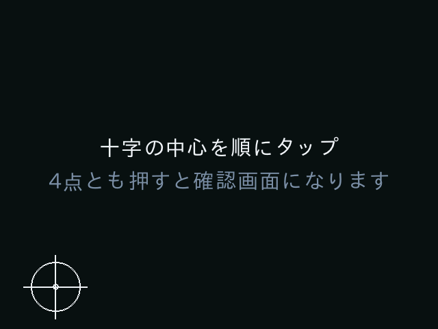
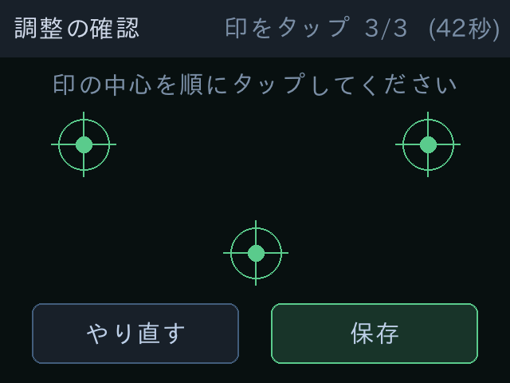

# CW Decoder 4 (ESP32 版) 取扱説明書

CW Decoder 4 (ESP32 版) の使い方を説明します。対象はファームウェア v3.7 です。
ビルド方法は [README](../README.md)、デコードの仕組みは [デコードアルゴリズム](decoder.md) を参照してください。

- [CW Decoder 4 (ESP32 版) 取扱説明書](#cw-decoder-4-esp32-版-取扱説明書)
  - [各部の名称](#各部の名称)
  - [起動](#起動)
  - [画面一覧](#画面一覧)
  - [操作方法](#操作方法)
    - [SETUP](#setup)
      - [Wi-Fi設定 (最初に行ってください)](#wi-fi設定-最初に行ってください)
      - [FW自動更新](#fw自動更新)
      - [FW手動更新](#fw手動更新)
      - [時刻合わせ](#時刻合わせ)
      - [NR(ALE)](#nrale)
      - [タッチパネル調整](#タッチパネル調整)
      - [初期化](#初期化)
      - [ログ出力](#ログ出力)
      - [About](#about)
    - [デコード画面](#デコード画面)
    - [時計画面](#時計画面)
      - [時刻の同期](#時刻の同期)

## 各部の名称

本体は、CYD (Cheap Yellow Display) とアナログボードの 2 枚の基板で構成されています。回路は [回路図](schematic.pdf) を参照してください。

背面には、左から次の端子が並んでいます。

| 名前 | 説明 |
|---|---|
| ボリューム | 入力レベルを調整します |
| AUDIO IN | 無線機の音声出力を 3.5mm プラグで接続します。接続すると内蔵マイクは OFF になります |
| AUDIO OUT | AUDIO IN の音をそのまま出力します。ヘッドホンや外部スピーカーを接続します |
| 電源スイッチ | プッシュ式です。押すたびに電源の ON/OFF が切り替わります |
| DC ジャック | DC 9〜12V を入力します (外径 5.5mm / 内径 2.1mm、センタープラス)。9V・1A 程度の AC アダプタを推奨します |

AUDIO IN に何も接続していないときは、内蔵マイクで無線機のスピーカーの音を入力します。

CYD の USB Micro-B 端子は、PC と接続して、ファームウェアの書き込みやログ出力に使います。ここから給電することもできます。

**入力レベルの合わせ方**: 信号を受信しながらボリュームを回し、スペクトラムの入力レベルメーターが
黄色の目盛 (−5 dBFS) を超えない程度に合わせてください。赤の範囲や `CLIP` が表示されるほど大きいと、正しくデコードできません。

## 起動

電源スイッチを押すと起動画面 (スプラッシュ) が表示されます。SETUP の `FW自動更新` が ON で Wi-Fi を
設定してあれば、この間に時刻の同期とファームウェアの新版チェックを行い、進行状況を画面下部に表示します。
完了するとデコード画面に切り替わります。

## 画面一覧

**デコード画面**

&emsp;&emsp;

左が欧文、右が和文 (JP モード)。和文の開始 (ホレ) と終了 (ラタ) は `「` `」` で表示します。

- 最上段: ステータス行。`US`/`JP`・`TONE`・`SETUP` のボタン、受信速度 WPM (Words Per Minute)、時計を表示します
- 上 2/3: デコードした文字 (16 文字 × 6 行)。和文はカタカナで表示し、濁点 / 半濁点は自動で合成します
- 下 1/3 左: スペクトラム (約 300〜1200Hz)。TONE で選べる範囲 (600〜1000Hz) と、受信中の周波数を帯で示します。
  上端は入力レベルメーターです (赤は入力過大、`CLIP` は入力が上限に達した状態)
- 下 1/3 右: オシロスコープ (約 3.6 秒分)。次の 3 つを重ねて表示します
  - `RAW`: 入力された音声の波形
  - `ENV`: 受信周波数の成分の強さ
  - `KEY`: 抽出したマーク / スペースと、デコードした文字

**時計画面**

- 上段: パタパタ時計 (split-flap) と日付。日付の右に、選択中の国のコードを表示します
- 下段: 12 か国の現在時刻 (UTC との時差が大きい順、6 列 × 2 行)

**SETUP 画面**

| メニュー | 説明 |
|---|---|
| [Wi-Fi設定](#wi-fi設定-最初に行ってください) | 自宅の Wi-Fi を設定します |
| [FW更新](#fw手動更新) | ブラウザから手動でファームウェアを更新します |
| [NR(ALE)](#nrale) | NR (Noise Reduction) の ON/OFF |
| [タッチパネル調整](#タッチパネル調整) | タッチ位置を補正します |
| [時刻合わせ](#時刻合わせ) | 時刻・夏時間の設定と、NTP 同期 |
| [FW自動更新](#fw自動更新) | 起動時の新版チェックの ON/OFF |
| [ログ出力](#ログ出力) | スコープビューア用のログ出力の ON/OFF |
| [初期化](#初期化) | Wi-Fi の設定を消去します |
| [About](#about) | バージョンなどの情報を表示します |

## 操作方法

### SETUP

デコード画面のステータス行にある `SETUP` ボタンで開きます。右上の `戻る` でデコード画面に戻ります。

#### Wi-Fi設定 (最初に行ってください)

本体を自宅の Wi-Fi に接続しておくと、NTP (Network Time Protocol) による時刻合わせと、ファームウェアの新版チェックを自動で行います。
Wi-Fi を設定しないと、時計はビルドした日時から始まり、新版のチェックも行いません。

SSID (Service Set Identifier) とパスワードは、スマートフォン (または PC) のブラウザから入力します。

1. SETUP の `WiFi設定` を押します。受信を停止し、本体が Wi-Fi のアクセスポイント
   (SSID `CWDEC-OTA` / パスワード `cwdecoder`) になり、下の画面が表示されます。

   

2. スマートフォンのカメラで画面右の **QR コード**を読み取り、表示に従って `CWDEC-OTA` に接続します。
   QR コードを読み取れないときは、スマートフォンの Wi-Fi 設定で `CWDEC-OTA` を選び、パスワード `cwdecoder` を入力します。
3. 接続すると「ネットワークにサインイン」の通知 (または自動ポップアップ) から設定ページが開きます。
   開かないときは、ブラウザで `http://192.168.4.1/` を開きます。
4. 設定ページに自宅 Wi-Fi の **SSID** と**パスワード**を入力して `保存` を押します。

   

5. 本体の画面に「WiFi設定を保存しました」と表示され、SETUP 画面に戻ります。
   スマートフォンの接続先は、自宅の Wi-Fi に戻してください。

- 本体 (ESP32) が接続できるのは **2.4GHz 帯の Wi-Fi だけ**です。5GHz 専用の SSID は使用できません。
- 設定を取り消すときは本体の `キャンセル` を押します。設定した内容を消去するときは [初期化](#初期化) を使います。
- 受信 (デコード) をしている間は Wi-Fi を使いません。無線のノイズで受信を妨げないためです。

#### FW自動更新

(既定 ON): 起動時に数秒だけ Wi-Fi に接続し、時刻の同期とファームウェアの新版チェックを行います。
新版があると `新しいファームウェアがあります v3.6 → v3.7` のように表示されるので、`更新` を押すとファームウェアを更新して再起動します。
Wi-Fi を設定していないとき、OFF のとき、接続に失敗したときは、通常どおり起動します。

**v3.4 / v3.5 をお使いの場合**: この 2 つの版は起動時のチェックが失敗し (`更新はありません` と表示されます)、
オンラインでは更新できません。[USB 書き込みツール](https://pokibon3.github.io/cw_decoder4/flasher/) か
[FW手動更新](#fw手動更新) で v3.6 以降に更新してください。以降は自動で更新できます。

#### FW手動更新

ブラウザからファームウェアのファイル (.bin) をアップロードして更新します。SETUP の `FW更新` を押し、確認画面で `開始` を押すと
OTA (Over The Air) モードになります。
本体がアクセスポイント (`CWDEC-OTA` / パスワード `cwdecoder`) になるので、スマートフォンまたは PC を接続して `http://192.168.4.1/` から
`firmware.bin` をアップロードします (ファームウェアのファイルは GitHub リポジトリの `tools/v<版>/` にあります)。
完了すると再起動します。途中で失敗しても元のファームウェアは残るので、再起動すれば元の状態で起動します。
Wi-Fi を設定してあれば自宅の Wi-Fi にも同時に接続するので、PC から `http://cwdec.local/` でも更新できます
(LAN 側の IP アドレスは画面の `LAN` 行に表示されます)。

&emsp;&emsp;

左が確認画面、右が OTA モードの画面です。スマートフォンとの接続方法は [Wi-Fi設定](#wi-fi設定-最初に行ってください) と同じです。
iPhone のサインイン画面ではファイルを選べないことがあるので、Safari で開いてください。

#### 時刻合わせ

▲▼ で年月日時分を合わせて `決定` を押します。本体には RTC (Real Time Clock) がないため、電源を切るとビルド日時に戻ります。

- `夏時間`: 世界時計に夏時間を適用するかを切り替えます (ON のときは各国の規則に従って自動で切り替えます)
- `NTP同期`: すぐに NTP で時刻を合わせます (Wi-Fi を設定していないときは押せません)

#### NR(ALE)

(既定 ON): ON にすると ALE (Adaptive Line Enhancer) でトーンを強調し、
弱い信号を検出しやすくなり、ノイズによる誤表示も減ります ([デコードアルゴリズム](decoder.md#nr-noise-reduction-機能) 参照)。

#### タッチパネル調整

1. `開始` を押します。`既定に戻す` を押すと、調整値を消去して既定値に戻します。

   

2. 画面の四隅に順に表示される十字の中心をタップします。爪の先など、先の細いものでタップすると正確に調整できます。

   

3. 確認画面で、印の中心を順にタップします。3 点とも正しくタップすると `保存` が押せるようになります。
   正しくタップできないときは `やり直す` を押してください。45 秒以内に正しくタップできないときは、保存せずに SETUP 画面に戻ります。

   

**調整に失敗して、タッチで操作できなくなったとき**: [USB 書き込みツール](https://pokibon3.github.io/cw_decoder4/flasher/) の「設定を初期化」で既定値に戻せます (Wi-Fi などほかの設定も初期化されます)。

#### 初期化

設定した SSID / パスワードを消去し、NTP 同期を停止します。

#### ログ出力

(既定 ON): オシロスコープの表示データを USB シリアル (115200bps) に出力します。
[スコープビューア](https://pokibon3.github.io/cw_decoder4/scope/) を Chrome で開くと、PC でオシロスコープ画面を再現できます。
デコードには影響しないので、ON のままで問題ありません。

#### About

バージョン / ビルド日時 / 液晶コントローラ / 起動領域 / Wi-Fi / NTP の同期状況を表示します。

### デコード画面

- `US`/`JP` をタップ: 欧文 / 和文を切り替えます
- `TONE` をタップ: AUTO → 600 → 700 → 800 → 900 → 1000Hz の順に切り替えます。
  AUTO (緑色で表示、既定) は 500〜1000Hz で最も強い信号に自動で合わせます
- スペクトラムをタップ: タップした位置の周波数に受信を合わせます (AUTO は解除されます)
- オシロスコープの `RAW` / `ENV` / `KEY` をタップ: それぞれの表示を ON/OFF します
- スペクトラム / オシロスコープを**ダブルタップ**: そのパネルを全幅で表示します (もう一度ダブルタップすると戻ります)

  &emsp;&emsp;

- `SETUP` をタップ: SETUP 画面を開きます
- 文字エリアの中央付近をタップ: 時計画面に切り替えます

タッチした位置と反応する位置が合わないときは [タッチパネル調整](#タッチパネル調整) で合わせてください。

### 時計画面

時計画面を表示している間も、デコードを継続します。デコード画面に戻ると、その間に受信した文字が表示されます。

- 国のコードをタップ: パタパタ時計・日付・デコード画面の時計を、その国の時刻に切り替えます (選択した国は電源を切っても保持されます)
- パタパタ時計をタップ: デコード画面に戻ります

| コード | 国 / 地域 | 標準時 | 夏時間 |
|---|---|---|---|
| `ZL` | ニュージーランド | UTC+12 | 9月最終日曜〜4月第1日曜 |
| `VK` | オーストラリア東部 | UTC+10 | 10月第1日曜〜4月第1日曜 |
| `JA` | 日本 (既定) | UTC+9 | なし |
| `BY` | 中国 | UTC+8 | なし |
| `VU` | インド | UTC+5:30 | なし |
| `UA` | ロシア (モスクワ) | UTC+3 | なし |
| `DL` | ドイツ (欧州中部) | UTC+1 | 3月最終日曜〜10月最終日曜 |
| `UTC` | 世界標準時 | UTC | なし |
| `LU` | アルゼンチン | UTC−3 | なし |
| `W1` | 米国東部 | UTC−5 | 3月第2日曜〜11月第1日曜 |
| `W6` | 米国西部 | UTC−8 | 同上 |
| `KH6` | ハワイ | UTC−10 | なし |

夏時間は [時刻合わせ](#時刻合わせ) の `夏時間` が ON のときだけ適用します。

#### 時刻の同期

Wi-Fi を設定してあれば、次のときに NTP で時刻を自動で合わせます。

- 起動時 (FW自動更新が ON のとき)
- 時計画面を表示したとき (前回の同期から 24 時間以上経過していれば同期します。失敗したときは 1 時間後に再試行します)

同期中の数秒〜20 秒はデコードを停止します。デコード画面では Wi-Fi を使いません。
手動で合わせるときは [時刻合わせ](#時刻合わせ) の `NTP同期` を使います。
