# CW Decoder 4 (ESP32 版) 取扱説明書

ESP32 ボード (2.8inch CYD 系) で動く CW デコーダの使い方です。
対象はファームウェア v3.7 です。ビルドと配布の説明は [README](../README.md)、デコードの仕組みは
[デコードアルゴリズム](decoder.md) にあります。

画面の写真は、実機と同じ描画コードを PC で動かして撮ったものです (時刻などは撮った時点のものです)。

- [接続と電源](#接続と電源)
- [起動](#起動)
- [画面の見方](#画面の見方)
- [SETUP](#setup) — まず [WiFi設定](#wifi設定-最初に行ってください) を行ってください
- [操作](#操作)
- [時計画面](#時計画面)
- [時刻の同期](#時刻の同期)

## 接続と電源

本体は、CYD (液晶ボード) とアナログボードの 2 枚でできています。回路は [回路図](schematic.pdf) を参照してください。

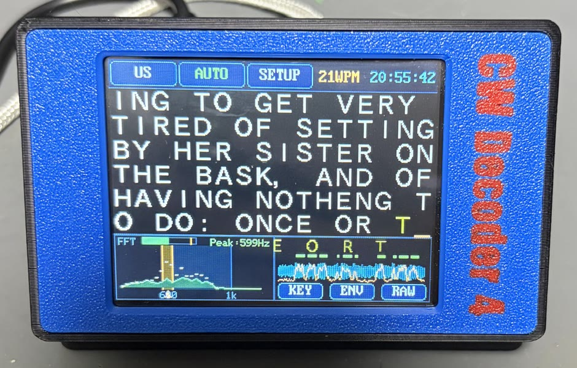

背面には、左から次の端子が並んでいます。

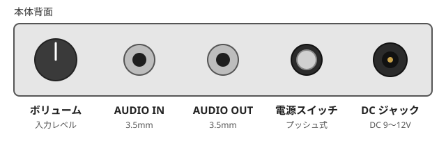

| 名前 | 説明 |
|---|---|
| ボリューム | 入力レベルを調整します |
| AUDIO IN | 無線機の音声出力を 3.5mm プラグでつなぎます。つなぐと内蔵マイクは OFF になります |
| AUDIO OUT | AUDIO IN の音をそのまま出力します。ヘッドホンや外部スピーカーをつなぎます |
| 電源 SW | プッシュ式です。押すたびに電源の入 / 切が切り替わります |
| DC ジャック | DC 9〜12V を入力します (外径 5.5mm / 内径 2.1mm、センタープラス)。9V・1A 程度の AC アダプタを推奨します |

AUDIO IN に何もつながないときは、内蔵のマイクで無線機のスピーカーの音を拾います。

CYD 側には、次の 2 つがあります。

| 名前 | 説明 |
|---|---|
| USB Micro-B 端子 | PC とつないで、ファームウェアの書き込みやログ出力に使います。ここから給電することもできます |
| BOOT ボタン | トーンやモードの切り替えに使います ([操作](#操作) 参照) |

**入力レベルの合わせ方**: 信号を受信しながらボリュームを回し、FFT パネルの入力レベルメーターが
黄色の目盛 (−5 dBFS) を超えない程度に合わせてください。赤の範囲や `CLIP` の表示が出るほど大きいと、デコードの精度が落ちます。

## 起動

電源スイッチを入れると起動画面 (スプラッシュ) が出ます。SETUP の `FW自動更新` が ON で WiFi を
設定してあれば、この間に時刻の同期とファームウェアの新版チェックを行い、状況を最下段に出します。
終わるとデコーダ画面になります。

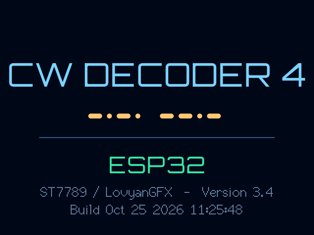

## 画面の見方

&emsp;&emsp;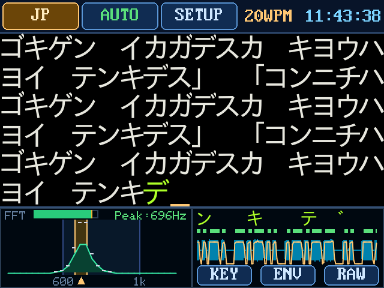

左が欧文、右が和文 (JP モード)。和文の `「` `」` は「ホレ」「ラタ」(和文の開始・終了) の表示です。

- 最上段: ステータス行 (`US`/`JP`、`TONE` (AUTO/600〜1000)、`SETUP` の各ボタン、xxWPM (受信中の速さ。WPM は Words Per Minute = 1 分間に送る語数)、
  右端に時計 HH:MM:SS = 世界時計で選択中の国の時刻)
- 上 2/3: デコード文字エリア 16 列 x 6 行 (24x24 の全角フォント。英数字も全角で表示します。和文はカタカナで、濁点 / 半濁点は自動で合成します)
- 下 1/3 左: FFT (Fast Fourier Transform: 高速フーリエ変換) によるスペクトラム (ヘッダに入力レベルメーター: dB スケール −50〜0 dBFS。dBFS は ADC (アナログ / デジタル変換器) が扱える最大の振幅を 0dB とした単位で、0 dBFS ≈ 1.55V ピーク。
  黄の目盛 −5 dBFS ≈ 0.85V ピークが ADC の直線範囲の上限、−2.5 dBFS 以上は赤、レール到達で `CLIP` 表示) (約 300〜1200Hz、1bin = 31.25Hz のライン表示とピークホールド。TONE の選択範囲 600〜1000Hz のガイド帯と、選択中のトーンの検出帯域 (±33Hz) も表示)
- 下 1/3 右: オシロスコープ (約 3.6 秒分。生波形の min/max の帯、トーンのエンベロープ、キー判定を同じ時間軸に色分けして重ねます。
  キー判定バーの上には、デコードした文字がその符号の中央の位置に表示され、掃引とともに左へ流れます。
  `KEY` ボタンで判定バーと文字を一緒に ON/OFF します)

## SETUP

デコーダ画面のステータス行にある `SETUP` ボタンを押すと SETUP 画面になります。
項目は 2 列に並びます。右上の `戻る` でデコーダ画面に戻ります。

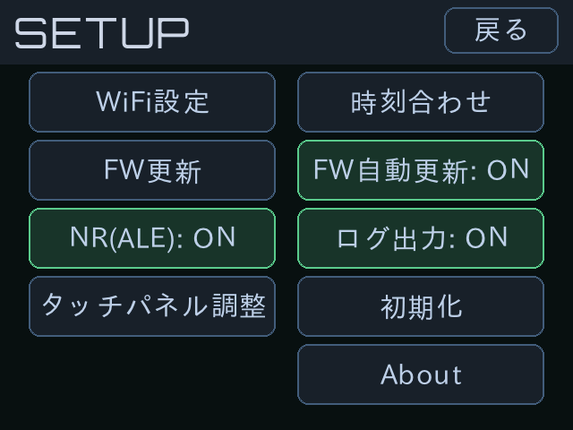

```
WiFi設定          時刻合わせ
FW更新            FW自動更新: ON
NR(ALE): ON       ログ出力: ON
タッチパネル調整  初期化
                  About
```

### WiFi設定 (最初に行ってください)

本体を自宅の WiFi につないでおくと、次のことが自動で行われます。WiFi を設定しないと、
時計はビルドした日時から始まり、ファームウェアの更新も確かめません。

- 起動時の**時刻合わせ** (NTP: Network Time Protocol、ネット経由の時刻合わせ) と**ファームウェアの新版チェック** ([FW自動更新](#fw自動更新))
- 時計画面を表示している間の、1 日 1 回の時刻合わせ ([時刻の同期](#時刻の同期))

本体にはキーボードが無いので、SSID (WiFi のネットワーク名) とパスワードはスマホ (または PC) のブラウザから入力します。

1. SETUP の `WiFi設定` を押します。受信を止め、本体が WiFi のアクセスポイント
   (SSID `CWDEC-OTA` / パスワード `cwdecoder`) になって、下の画面が出ます。

   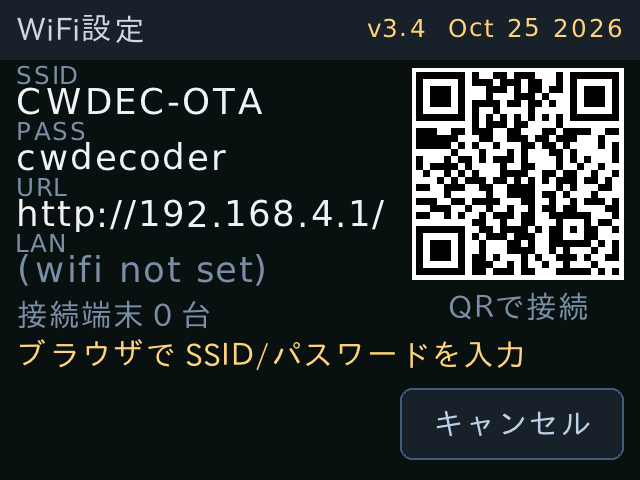

2. スマホのカメラで画面右の **QR コード**を読み、表示に従って `CWDEC-OTA` に接続します。
   QR が使えないときは、スマホの WiFi 設定で `CWDEC-OTA` を選び、パスワード `cwdecoder` を入れます。
3. 接続すると「ネットワークにサインイン」の通知 (または自動ポップアップ) から設定ページが開きます。
   開かないときは、ブラウザで `http://192.168.4.1/` を開きます。
4. 設定ページに自宅 WiFi の **SSID** と**パスワード**を入れて `保存` を押します。
5. 本体の画面に「WiFi設定を保存しました」と出て、SETUP 画面に戻ります。
   スマホは自宅の WiFi に戻してください。

- 本体 (ESP32) がつなげるのは **2.4GHz 帯の WiFi だけ**です。5GHz 専用の SSID は選べません。
- やめるときは本体の `キャンセル` を押します。設定した内容を消すときは [初期化](#初期化) を使います。
- 受信 (デコード) をしている間は WiFi を一切使いません。無線のノイズで受信を妨げないためです。

### FW自動更新

(既定 ON): 起動時 (スプラッシュの直後) に WiFi へ数秒だけ接続し、**NTP 時刻同期と
ファームウェアの新版チェックを 1 回の接続でまとめて** 行います。新版があれば画面に
`新しいファームウェアがあります v2.6 → v2.7` と出るので、`更新` / `キャンセル` を選びます。
`更新` を選ぶと GitHub Pages から自分のパネル用の bin を取得して書き換え、再起動します。
WiFi を設定していないとき、OFF にしたときは何もせず通常どおり起動します。
接続や取得に失敗しても、メッセージを出すだけでそのまま通常どおり起動します。

**v3.4 / v3.5 をお使いの場合**: この 2 つの版は起動時のチェックが失敗し (`更新はありません` と出る)、
オンラインでは更新できません。[USB 書き込みツール](https://pokibon3.github.io/cw_decoder4/flasher/) か
[FW更新](#fw更新) で一度だけ v3.6 以降にしてください。以後はまた自動で更新できます。

### FW更新

ブラウザからファームウェアの bin をアップロードして更新します。確認画面で `開始` を押すと OTA (Over The Air: ネットワーク経由の更新) モードになります。
本体が AP (アクセスポイント: `CWDEC-OTA` / パスワード `cwdecoder`) になるので、スマホまたは PC を接続して `http://192.168.4.1/` から
`firmware.bin` をアップロードします (`tools/v<版>/firmware_<パネル>.bin`。無ければ `sh tools/make_release.sh` で作ります)。
完了すると再起動します。途中で失敗しても旧ファームウェアが残ります (戻るには再起動してください)。
WiFi を設定してあれば **AP と同時に自宅の WiFi にも接続 (AP+STA。STA は WiFi の子機として接続すること)** するので、PC のネットワークを切り替えずに
`http://cwdec.local/` (mDNS: IP アドレスの代わりに名前でつなぐ仕組み) でも更新できます。LAN 側の IP は画面の `LAN` 行に出ます。

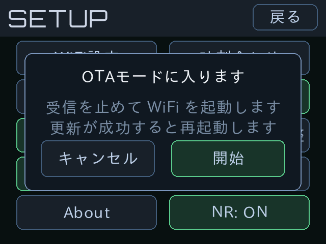&emsp;&emsp;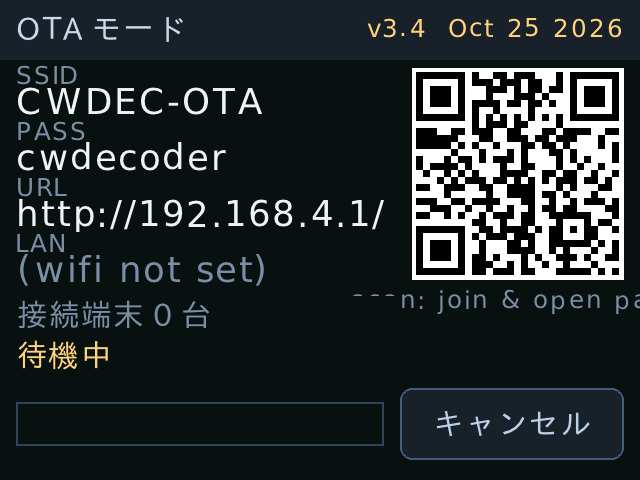

左が確認画面、右が OTA モードの画面です。スマホとのつなぎ方は [WiFi設定](#wifi設定-最初に行ってください) と同じです
(AP は**キャプティブポータル**になっています。iPhone のサインイン画面ではファイル選択ができないことがあるので、OTA は Safari で開くのが確実です)。

### 時刻合わせ

▲▼ で年月日時分を合わせて `決定` を押します。本体には時計の IC (RTC: Real Time Clock) が無いので、電源を切るとビルド日時に戻ります。

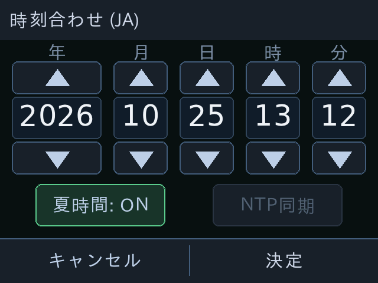

- `夏時間`: 世界時計の夏時間を使うか (ON のとき各国の規則で自動計算)。押すとすぐ切り替わって保存され、
  表示中の時刻も新しい時差に合わせて動きます
- `NTP同期`: その場で NTP から時刻を取り込み、成功したら SETUP に戻ります (秒まで合うので `決定` は不要)。
  WiFi を設定していないときは灰色で押せません

### NR(ALE)

(既定 ON): ノイズ低減 (NR: Noise Reduction) です。ON にすると ALE (Adaptive Line Enhancer: 適応型ラインエンハンサ) を使ってトーンを検出し、
弱い信号の感度が上がって、ノイズからの偽文字が減ります ([デコードアルゴリズム](decoder.md#ノイズ低減-nr-ale) 参照)。
OFF にすると従来方式になります。設定は NVS (Non-Volatile Storage: 電源を切っても消えない保存領域) に保存され、次の起動でも同じ状態で始まります。

### タッチパネル調整

縦横 1/8 だけ内側に出る十字を 4 点タップして座標を校正します (端はベゼルが近く狙いにくいので
内側で測り、四隅の値は一次式で外挿します)。続く確認画面では 3 点の的を順に当ててもらい、3 点とも当たって
はじめて `[保存]` が押せます (上下逆のままの補正を「たまたま保存」できないようにするため)。
保存先は NVS (`cwdec` / `touchcal`、16 バイト) で、次回起動時に自動で適用されます。
`[やり直す]` で再校正、45 秒当たらなければ破棄して戻ります。`[既定に戻す]` で `src/lgfx_config.h` の既定値へ。

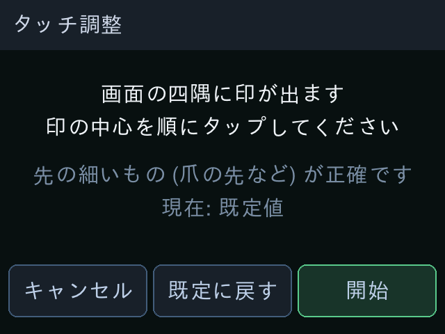

**ズレた値を保存してしまったときの復帰**: `BOOT` ボタンを押したまま電源を入れ、そのまま 2 秒押し続けると
校正値を消して既定値に戻します (タッチを一切使いません)。タッチが効かなくなっても必ずこれで戻せます。
PC があれば、[USB 書き込みツール](https://pokibon3.github.io/cw_decoder4/flasher/) で同じ版を「設定を初期化」して書き直しても戻せます
(こちらは WiFi などほかの設定も既定値に戻ります)。
v2.6 でスプラッシュ下端の案内表示をやめた (画面からはみ出すうえ、その行を起動時の
時刻同期・更新状況の表示に使うため) ので、**復帰方法はここにだけ書いてあります**。
なお、4 点がつぶれているなど明らかに壊れた値は、保存時にも読み込み時にもはじきます。

### 初期化

設定した SSID / パスワードを消去し、NTP 同期を止めます。

### ログ出力

(既定 ON): スコープ画面の元データ (列ごとの min/max・エンベロープ・キー判定、デコード文字、
WPM / トーン、入力レベル) をシリアル (115200bps) にテキストで出力します。PC で画面を再現するためのもので、
出力は表示側 (Core 1) の非ブロッキング処理なのでデコーダには影響しません。行の形式は `src/scopelog.h` を参照してください。
スコープビューア (<https://pokibon3.github.io/cw_decoder4/scope/>) を Chrome で開くと、このログからスコープ画面を再現できます (保存したログの再生もできます)。
受け手がいなければ捨てられるだけなので、常に ON のままで構いません。

### About

バージョン / ビルド日時 / パネル / 起動領域 / WiFi / NTP の同期状況を表示します。

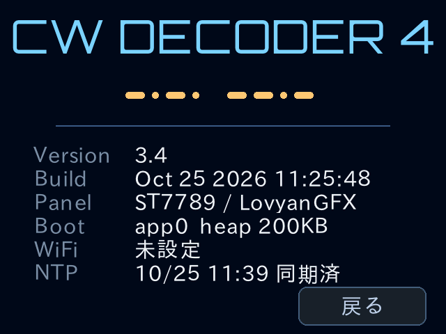

## 操作

- ステータス行の `US`/`JP` バッジをタップ: 欧文 / 和文モードを切り替えます
- ステータス行の `TONE` ボタン (US/JP と同じ形) をタップ: AUTO → 600 → 700 → 800 → 900 → 1000Hz の順に切り替えます
  (AUTO は 500〜1000Hz の最も強い信号へ自動で同調します。緑色で表示され、これがデフォルトです。
  1000Hz から AUTO へ戻したときは 600Hz から探し直します)
- FFT パネル内をタップ: タップした位置の周波数に最も近いトーンを手動で選びます (AUTO は解除されます)
- FFT / オシロの波形部分を**ダブルタップ**: そのパネルを横幅いっぱいに広げます
  (もう一度ダブルタップすると戻ります)。掃引レートや周波数レンジは変わらないので、
  見える範囲がそのまま 2 倍になります。広げている間、もう一方のパネルは隠れます

  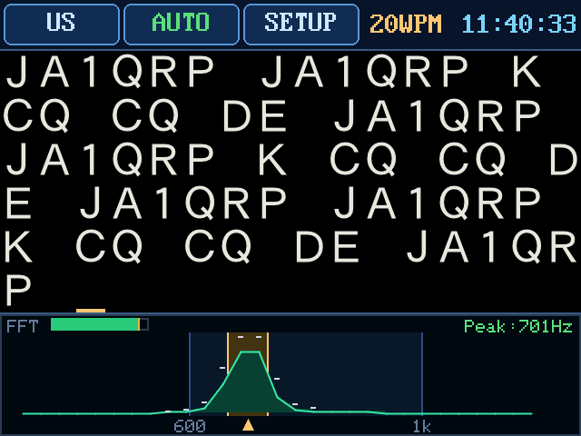&emsp;&emsp;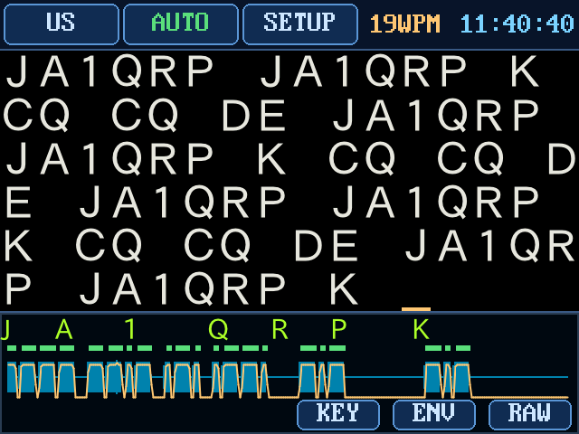

- ステータス行の `SETUP` ボタンをタップ: SETUP 画面を開きます
- 文字エリアの中央付近をタップ: 時計画面に切り替えます (時計の中央をタップすると戻ります)

BOOT ボタンでも操作できます (短押し: トーンの切り替え / 800ms の長押し: モードの切り替え)。
タッチ座標がズレる場合は SETUP の **タッチパネル調整** で合わせてください (結果は NVS に保存)。
校正しないときの既定値は `src/lgfx_config.h` の `TOUCH_ST7789` / `TOUCH_ILI9341` (パネルごと) です。
調整をやり直せなくなったときは、`BOOT` を押しながら電源を入れて 2 秒押し続けると消去できます。

## 時計画面

デコーダ画面で文字エリアの中央付近をタップするとパタパタ (split-flap) の**世界時計**に切り替わります。

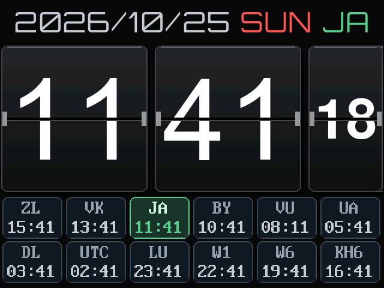

時計表示中もデコーダは裏で動き続け、受信した文字は溜まっているので、
時計の中央をタップしてデコーダ画面へ戻ると最新の内容が表示されます。

画面下段には 12 か国の現在時刻 (朝が早い順、6 列 × 2 行) が並びます。コードのボタンを押すと、
パタパタ時計と日付・デコーダ画面の時計がその国の時刻に切り替わります (日付の右にコードを表示)。
選んだ国は NVS に保存され、次の起動でも同じ国の時刻を表示します。
パタパタ時計の部分をタップするとデコーダ画面へ戻ります。

| コード | 国 / 地域 | 標準時 | 夏時間 |
|---|---|---|---|
| `ZL` | ニュージーランド | UTC+12 | 9月最終日曜〜4月第1日曜 |
| `VK` | オーストラリア東部 | UTC+10 | 10月第1日曜〜4月第1日曜 |
| `JA` | 日本 (既定) | UTC+9 | なし |
| `BY` | 中国 | UTC+8 | なし |
| `VU` | インド | UTC+5:30 | なし |
| `UA` | ロシア (モスクワ) | UTC+3 | なし |
| `DL` | ドイツ (欧州中部) | UTC+1 | 3月最終日曜〜10月最終日曜 |
| `UTC` | 世界標準時 | UTC | なし |
| `LU` | アルゼンチン | UTC−3 | なし |
| `W1` | 米国東部 | UTC−5 | 3月第2日曜〜11月第1日曜 |
| `W6` | 米国西部 | UTC−8 | 同上 |
| `KH6` | ハワイ | UTC−10 | なし |

夏時間は [時刻合わせ](#時刻合わせ) の `夏時間` が ON のときだけ適用します (設定は NVS に保存)。

## 時刻の同期

NTP 時刻同期 (WiFi を設定した場合) は **起動時 (FW自動更新が ON のとき)** と、
**時計画面を表示している間** に自動で実行されます。[時刻合わせ](#時刻合わせ) の `NTP同期` で手動でも同期できます
(時計画面では起動 15 秒後以降の初回、以後 24 時間ごと。失敗時は 1 時間後に再試行。
起動時に同期できた場合は次回を 24 時間後に繰り延べるので二重には走りません)。
同期中の数秒〜20 秒は、無線のノイズを避けるため DSP を一時停止します。
**デコーダ画面では WiFi を一切起動しません。**
